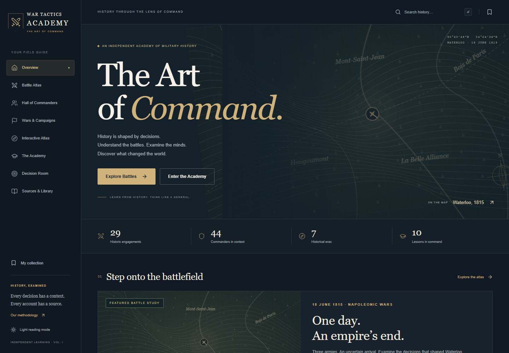

# War Tactics Academy

**The Art of Command — Learn from History. Think Like a General.**

[](https://github.com/darkonaumovski/war-tactics-academy/actions/workflows/deploy.yml)

**Live site: [darkonaumovski.github.io/war-tactics-academy](https://darkonaumovski.github.io/war-tactics-academy/)**

A historical learning application about military history, command decisions and their consequences. It combines a battle atlas, commander profiles, wars and campaigns, a decision simulator and a structured academy. It is built with Next.js, React, TypeScript, Prisma and SQLite, and is published as a fully static site on GitHub Pages. No login, paid service, remote database or API key is required.

The guiding principle is to explain what commanders knew, what they decided and why, and to keep historical fact, scholarly interpretation, uncertainty and counterfactual reasoning clearly apart.



## Features

### Historical catalog

- **59 engagements** across seven eras, classified as battles, sieges, operations or campaigns, with approximate locations. Operation Overlord (Normandy) is the first operation record.
- **Fifty-nine detailed studies**, one for every engagement in the catalog, each with 14 analysis sections and an interactive replay of four or more phases. 823 of the 826 sections show which listed sources they draw on, with book and chapter locators for classical texts and chronicles and section names for handbooks.
- **117 command perspectives** across every engagement except Marathon. Each covers objective, available information, uncertainty, constraints, forces, terrain, logistics, decisions and retrospective interpretation, clearly presented as reconstructed reasoning rather than quotations.
- **44 commander profiles**, each with a command role (ruler-commander, field, naval, staff planner, or coalition and theater commander), ranks and titles, principal commands, a dated chronology, a notable decision, defeats and reverses, linked engagements and further reading. The catalog filters by era and command role, and any two commanders can be compared side by side without numerical ratings.
- **33 war pages** with principal participants, geographic scope, a chronology of key developments, key commanders and reading from linked studies and profiles; each links to its campaigns and engagements.

### Interactive learning

- **Battle replay** with pan, zoom, phase selection, playback, event popups, a legend and a full text timeline. Replay diagrams are labeled as schematic, never as surveyed troop positions.
- **Offline world atlas** using bundled Natural Earth geography; no map tile server is needed.
- **Six decision exercises** (Waterloo, Cannae, Midway, Austerlitz, Alesia and Hastings): read the situation, choose under uncertainty, then compare with what happened and with an explicitly counterfactual interpretation.
- **Four learning paths with 21 lessons**: Foundations of Military History, Classical Warfare, Napoleonic Warfare, and Industrial and World Wars. Each lesson has objectives, historical cases, a concept diagram and a quiz; the Classical and Industrial lessons add readings and seminar prompts.
- **Curated media library** of nine verified records: two official National Archives (UK) D-Day videos, loaded only on request through privacy-enhanced YouTube embeds; public-domain portraits of Grant and Eisenhower, also shown on their profiles; two historic maps; and three primary documents. Each record stores publisher, license, attribution and verification date.
- **Search and filters**: global search across battles, commanders, wars, campaigns and lessons, plus era, region, category and command-role filters.
- **Saved progress** in the browser: bookmarks, recently visited records, lesson scores, decision choices and the light or dark theme. No account is needed.

### Design and accessibility

- Editorial dark interface with an optional light theme, a desktop sidebar and mobile navigation.
- Self-hosted typography: Cormorant Garamond for headings, Source Serif 4 for reading text, Inter for the interface and IBM Plex Mono for labels and coordinates.
- Subtle motion: home-page sections fade up as they scroll into view, and new timeline phases and quiz or decision feedback ease in. Nothing is hidden or moved for readers who prefer reduced motion, and content is visible without JavaScript.
- Every page has its own title, description, canonical URL and link-preview (Open Graph and Twitter) metadata, and a [sitemap](https://darkonaumovski.github.io/war-tactics-academy/sitemap.xml) lists all content pages.
- Keyboard navigation, a skip link, semantic landmarks and automated accessibility checks on 14 pages in the dark theme and 5 in the light theme.

## Technology

| Area       | Choice                                                                                 |
| ---------- | -------------------------------------------------------------------------------------- |
| Framework  | Next.js 16.4.3 App Router, static export (`output: "export"`)                          |
| UI         | React 19.3.1, TypeScript (strict), plain CSS with design tokens, Lucide icons          |
| Typography | `next/font` with four SIL Open Font License families, self-hosted                      |
| Motion     | Motion 13.5.1 through `LazyMotion`, respecting reduced-motion settings                 |
| Data       | Prisma 7.10.1 with SQLite, read at build time; Zod validation                          |
| Maps       | d3-geo with bundled Natural Earth data (`world-atlas`); SVG replay diagrams            |
| Testing    | Vitest and React Testing Library; Playwright (Chromium, Firefox, WebKit) with axe-core |
| Hosting    | GitHub Pages, deployed by GitHub Actions on every push to `main`                       |

## Quick start

Prerequisites: Node.js **22.12 or later** (tested with Node 24.20.0) and npm. SQLite is embedded; no separate database server is needed. Internet access is needed to install packages and browsers and to download fonts during the first build.

```sh
git clone https://github.com/darkonaumovski/war-tactics-academy.git
cd war-tactics-academy
npm ci
npm run db:setup
npm run dev
```

Open **http://127.0.0.1:3000**. In PowerShell environments that block npm's `.ps1` shim, use `npm.cmd` instead of `npm`.

The default database is `prisma/academy.db`. Copy `.env.example` to `.env` only to change it:

```env
DATABASE_URL="file:./prisma/academy.db"
```

`npm run db:setup` generates the Prisma client, applies the checked-in migrations and seeds the catalog. After pulling changes, run it again (or `npm run db:migrate` followed by `npm run db:seed`). The seed is transactional and idempotent: it updates existing records, replaces each record's source links and removes campaigns no longer in the data; other removed records are not pruned automatically. Browser progress is independent of the database.

## Production build and deployment

```sh
npm run build
npm start
```

`npm run build` reads the seeded catalog once and prerenders every page (171 pages plus `sitemap.xml`) into `out/`. `npm start` serves `out/` on http://127.0.0.1:3000 with `scripts/serve-static.mjs`, which behaves like GitHub Pages: folder paths resolve to `index.html`, paths without a trailing slash redirect, and unknown paths return the custom `404.html` with a 404 status. The deployed site needs no server or database.

### GitHub Pages

The site is live at **[darkonaumovski.github.io/war-tactics-academy](https://darkonaumovski.github.io/war-tactics-academy/)**. [`.github/workflows/deploy.yml`](.github/workflows/deploy.yml) runs on every push to `main`. It installs dependencies, sets up and seeds the database, runs lint, type checking and unit tests, builds with `BASE_PATH=/<repository-name>/` and `SITE_URL` set to the Pages address, and publishes `out/`. If any check fails, the previous version stays live. Progress is visible in the repository's [Actions tab](https://github.com/darkonaumovski/war-tactics-academy/actions).

To set this up in a fork: Settings → Pages → Source: "GitHub Actions". On a free GitHub plan, Pages requires a public repository.

To preview the Pages URL layout locally:

```sh
BASE_PATH=/war-tactics-academy/ npm run build
BASE_PATH=/war-tactics-academy/ npm start
```

Then open http://127.0.0.1:3000/war-tactics-academy/. In Git Bash on Windows, prefix both commands with `MSYS_NO_PATHCONV=1` so the path is not rewritten.

Static hosting shapes a few details: URLs end with a trailing slash; search terms and battle filters in the query string (`?q=`, `?era=`) are applied in the browser; the video tab is its own page (`/library/videos/`); portraits load directly from the holding archive because there is no image optimizer; and catalog changes reach the site only through a new build.

## Testing

```sh
npm run lint
npm run typecheck
npm test
npm run test:e2e:chromium
npm run test:e2e
npm run test:report
```

- **Unit and component tests** (Vitest, 41 tests): date formatting, search and filters, phase selection, decision state, quiz scoring, persistence, data integrity, content depth, media records, metadata, and the quiz and media-library components.
- **Browser tests** (Playwright, 45 scenarios in each of Chromium, Firefox and WebKit, 135 in total): main workflows, bookmarks and saved progress, timelines, the atlas without network access, search, metadata and the sitemap, scroll reveals and reduced motion, responsive layouts at 375, 768 and 1440 pixels, runtime errors, and axe-core accessibility checks.

Playwright builds the static export and serves it automatically, so tests run against the files that are deployed. `PLAYWRIGHT_BASE_URL` targets an already running server instead. Install browsers when needed with `npx playwright install chromium firefox webkit`. Reports are written to `playwright-report/` and `test-results/`.

See [verification results](docs/VERIFICATION.md) for the latest runs and [test strategy](docs/TEST_STRATEGY.md) for coverage. `node scripts/capture-preview.mjs` refreshes the screenshots in `docs/screenshots/` while the local server is running.

## Project structure

```text
app/                  Root layout, fonts, one route per page, sitemap, error and 404 pages, styles
components/views/     Page views, one module per section (battles, commanders, wars, academy…)
components/           Reusable UI, catalogs, maps, quizzes, search, media, motion and progress
data/                 Engagements, commanders, wars, research, learning, scenarios and media
lib/                  Types, Prisma client, catalog loader, validation, metadata and persistence
prisma/               Relational schema, migrations and transactional seed
tests/unit/           Vitest unit and component tests
tests/e2e/            Playwright workflow, accessibility and responsive tests
scripts/              Static server, preview capture and browser diagnostics
docs/                 Architecture, data model, sources, roadmap, test strategy and results
.github/workflows/    GitHub Pages deployment
```

Routes: `/`, `/battles`, `/battles/[slug]`, `/commanders`, `/commanders/[slug]`, `/commanders/compare`, `/wars`, `/wars/[slug]`, `/campaigns/[slug]`, `/atlas`, `/academy`, `/academy/[courseSlug]`, `/academy/[courseSlug]/[lessonSlug]`, `/simulator`, `/simulator/[scenarioSlug]`, `/library`, `/library/videos`, `/about`, `/search` and `/saved`, plus `/sitemap.xml`. Each dynamic route lists its pages at build time, so unknown paths and slugs show the custom not-found page. More detail is in [architecture](docs/ARCHITECTURE.md) and the [data model](docs/DATA_MODEL.md).

## Historical methodology

Historical fact, scholarly interpretation, uncertainty and counterfactual analysis are explicitly distinguished. Detailed studies cite institutional histories and primary texts, with caveats about retrospective testimony and conflicting evidence. The fifty-nine studies are concise editorial syntheses, not full scholarly monographs.

Study sections name the listed sources they draw on. These references were assigned only after each source page had been read; sources that could not be opened are listed but not attached to individual sections. They are section-level references, not footnotes for every sentence. Commander chronologies and war overviews summarize well-established events; their further reading is not a citation for each entry. All source links were checked, and dead links were replaced with verified pages.

No casualty totals, private thoughts, invented quotations, precise intelligence logs or commander performance ratings are fabricated. Geographic markers show approximate places. Replay geometry is an abstract teaching schematic, not verified troop coordinates or surveyed movements. Political and civilian consequences, including atrocities, remain part of the historical context.

See the [source audit](docs/SOURCE_AUDIT.md) and [commander sourcing notes](docs/COMMANDER_SOURCES.md). Specialist review and fuller contrasting bibliographies remain important next steps.

## Media and licensing

Map art, monograms and diagrams are original SVG graphics. Monograms are graphic identifiers, not likenesses; only commanders with an item-level public-domain portrait record show a photograph. Natural Earth world geography is public domain, distributed through `world-atlas`; [Natural Earth terms](https://www.naturalearthdata.com/about/terms-of-use/) apply.

The four typefaces are licensed under the SIL Open Font License. `next/font` downloads them at build time and serves them from the site, so visitors' browsers never contact Google. Only the Latin files (about 84 KB) are preloaded; other character ranges, such as Vietnamese, load only on pages that use them.

External readings remain with their publishers; no publisher artwork or full article is copied. Curated media lives in `data/media.json`, is validated by `lib/media.ts` and is also seeded into the `MediaResource` table with its source, publisher, license and attribution. Video IDs were checked against the publisher's own page and YouTube oEmbed; nothing is autoplayed or rehosted. Portraits load directly from the holding archive and fall back to a text notice with attribution if the image cannot load. Historic maps and documents are linked, not reproduced. See [media provenance](docs/MEDIA_RESEARCH_UPDATE.md).

## Release history

All releases are deployed to the live site.

| Commit    | Change                                                                                                                                                                                                        |
| --------- | ------------------------------------------------------------------------------------------------------------------------------------------------------------------------------------------------------------- |
| `26f1f2a` | Detailed studies for Toulon, Montenotte, Lodi, Castiglione and Arcole, opening the Napoleon collection; Napoleon linked to each.                                                                              |
| `a8afc32` | Detailed studies for Jerusalem, the Milvian Bridge, Adrianople and the Catalaunian Plains, completing the Roman collection; four war chronologies corrected.                                                  |
| `98c9685` | Detailed studies for Pharsalus, Actium, Teutoburg and Watling Street; Caesar linked to Pharsalus; three war chronologies corrected against read sources.                                                      |
| `4466f60` | Detailed studies for Zama, Cynoscephalae, Pydna and Carrhae, opening the Roman collection; Hannibal and Scipio linked to Zama; two war chronologies corrected.                                                |
| `b66a6f9` | Detailed studies for the Persian Gate, Jaxartes, Sogdian Rock and Hydaspes, completing Alexander's campaign; two new campaigns; Alexander's profile linked to each; source audit extended.                    |
| `18030e0` | Detailed studies for the Granicus, Issus, Tyre and Gaza, the first batch of Alexander's campaign; Alexander's profile linked to each; source audit extended.                                                  |
| `bbf87cf` | Catalog rows and studies split into per-collection modules; ten new wars for the Roman and Revolutionary-era expansion, with participants, scope and chronology.                                              |
| `e6658a4` | Detailed studies for Blenheim, Saratoga, Sedan, Tsushima and Tannenberg, the final batch: every catalog engagement now has a detailed study; source audit extended.                                           |
| `d44f192` | Detailed studies for the Fall of Constantinople, the First Battle of Panipat, Sekigahara and Breitenfeld, the third batch of the remaining catalog engagements; source audit extended.                        |
| `c8997fd` | Detailed studies for the Battle of Red Cliffs, Yarmouk, Hattin and Ain Jalut, the second batch of the remaining catalog engagements; tests now read the study list from the data file; source audit extended. |
| `9af01ec` | Detailed studies for Verdun, the Second Battle of El Alamein, Kursk and Dien Bien Phu, the first batch of the remaining catalog engagements; source audit extended.                                           |
| `501790c` | Detailed studies for Gaugamela, Agincourt, Gettysburg and Operation Overlord (Normandy), each with section-level references, a four-phase replay and two command perspectives; source audit extended.         |
| `3686290` | Self-hosted typography (four Open Font License families) and subtle Motion animations that respect reduced motion; accessibility checks extended to 14 pages.                                                 |
| `bcad0f9` | One App Router route per page, page views split into section modules, full page metadata and a sitemap; Operation engagement type, with Operation Overlord within the North-west Europe campaign.             |
| `cea7872` | Converted to a static export and published on GitHub Pages with an automatic deploy workflow; search and filters read the URL in the browser.                                                                 |
| `dd2ab3f` | Commander chronologies and command records, war context pages, extended and new command perspectives, section-level source references, three new decision exercises; dead source links replaced.              |
| `7931e1f` | Classical Warfare and Industrial and World Wars courses, the curated media library with portraits and official videos, and their tests.                                                                       |
| `1728672` | First edition: catalog, eight studies, atlas, replay, commanders, academy, simulator, bookmarks and tests.                                                                                                    |

## Known limitations

- The four learning paths are introductory editorial courses (one question per lesson), not reviewed university curricula.
- The fifty-nine battle analyses and 44 commander profiles need deeper scholarly review, fuller biographies and sentence-level citations before being treated as an academic reference work. Study sections are still brief.
- War pages give orientation, not comprehensive operational histories, and have no dedicated bibliography. Campaign pages remain indexes.
- Replay diagrams explain abstract relationships; they do not simulate combat or reconstruct exact formations. Atlas locations and Natural Earth coastlines are approximate modern context.
- The media library is a small starting collection (nine records); the two videos cover only D-Day. Embeds and archive images depend on third-party availability.
- Progress belongs to one browser and is lost if its storage is cleared; storage failures are reported without crashing.
- The site is static: the database is a build-time content store and updates require a rebuild. Accounts, synchronization, a historian-facing editor and sentence-level citation workflows are future work.
- Automated accessibility checks supplement, but do not replace, manual screen-reader testing. No Lighthouse score is claimed.

See the [prioritized roadmap](docs/PRODUCT_ROADMAP.md).
