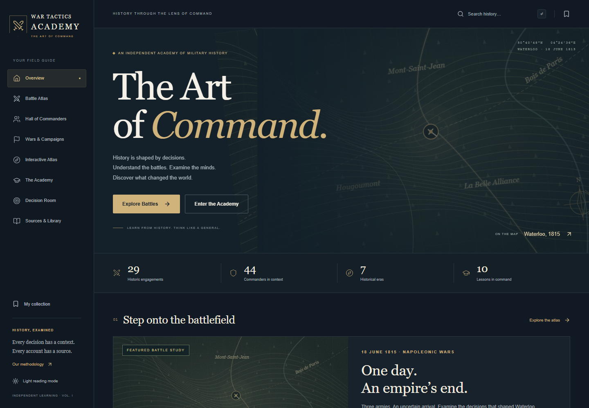

# War Tactics Academy

**The Art of Command — Learn from History. Think Like a General.**

[](https://github.com/darkonaumovski/war-tactics-academy/actions/workflows/deploy.yml)

**Live site: [darkonaumovski.github.io/war-tactics-academy](https://darkonaumovski.github.io/war-tactics-academy/)**

A historical learning application about military history, command decisions and their consequences. It combines a battle atlas, commander profiles, wars and campaigns, a decision simulator and a structured academy. It is built with Next.js, React, TypeScript, Prisma and SQLite, and is published as a fully static site on GitHub Pages. No login, paid service, remote database or API key is required.

The guiding principle is to explain what commanders knew, what they decided and why, and to keep historical fact, scholarly interpretation, uncertainty and counterfactual reasoning clearly apart.



## Features

### Historical catalog

- **178 engagements** across seven eras, classified as battles, sieges, operations or campaigns, with approximate locations. Operation Overlord (Normandy) is the first operation record.
- **178 detailed studies**, one for every engagement in the catalog, each with 14 analysis sections and an interactive replay of four or more phases. All 2,492 sections show which listed sources they draw on, with book and chapter locators for classical texts and chronicles and section names for handbooks.
- **384 command perspectives** across all 178 engagements. Each covers objective, available information, uncertainty, constraints, forces, terrain, logistics, decisions and retrospective interpretation, clearly presented as reconstructed reasoning rather than quotations.
- **132 commander profiles**, each with a command role (ruler-commander, field, naval, staff planner, or coalition and theater commander), ranks and titles, principal commands, a dated chronology, a notable decision, defeats and reverses, linked engagements and further reading. Commanders with two or more linked engagements get a career strip (one dot per engagement on a year axis, with a band for each war) and a dated list of those engagements with their outcomes. The catalog filters by era and command role, and any two commanders can be compared side by side without numerical ratings.
- **43 war pages** with principal participants, geographic scope, a chronology of key developments, key commanders and reading from linked studies and profiles; each links to its campaigns and engagements. Campaign pages draw a schematic map with the engagements numbered in date order (a locator map when a campaign has one engagement); the line joins them in that order and does not trace any army's movements. All 101 campaign pages add sourced text: a narrative for the sixty-six campaigns of the collections (the four of Alexander, the sixteen of Rome, the thirteen of Napoleon, the fifteen of the First World War, including the four of the Serbian Front, and the eighteen of the Second World War) and a short context for the thirty-five campaigns outside them. The Alexander, Roman, French Revolutionary, Napoleonic and both world war pages add an annotated war bibliography.
- **Six collections** (Alexander, Rome, Napoleon, the First World War, the Serbian Front and the Second World War), each with an introduction, a strategic arc that links the studies it summarises, a map of its engagements numbered in date order (joined by a line for Alexander and the Serbian Front), and a dated timeline. Membership follows wars and campaigns, so new studies join their collection automatically.

### Interactive learning

- **Battle replay** with pan, zoom, phase selection, playback, event popups, a legend and a full text timeline. Replay diagrams are labeled as schematic, never as surveyed troop positions.
- **Offline world atlas** using bundled Natural Earth geography; no map tile server is needed. Nearby markers merge into numbered groups that zoom in when selected, a region select frames dense areas such as the Balkans or northern Italy, markers that never separate fan out, and `/atlas?battle=<slug>` opens the map on one engagement.
- **Forty-two decision exercises** (Waterloo, Cannae, Midway, Austerlitz, Alesia, Hastings, the Hydaspes, Pharsalus, Auerstedt, Jutland, Leyte Gulf, the Teutoburg Forest, Borodino, the Marne in 1914, Market Garden, and six on the Serbian Front: Cer, the crossing into Syrmia, the Kolubara, the strike on Bulgaria proposed in 1915, the retreat of 1915 and Dobro Pole, and four from Napoleon’s campaigns written for the Leadership Lessons: raising the siege before Castiglione, stopping at Smolensk, the road home from Maloyaroslavets and the bridge at Leipzig, two from the Western Front written for the Leadership Lessons: breaking off at Amiens and the armistice terms at Senlis, three from Alexander’s campaigns written for the Leadership Lessons: besieging Tyre, Parmenion’s night attack before Gaugamela and turning back at the Hyphasis, three from Wellington’s written for the Leadership Lessons: leaving Spain after Talavera, relieving Ciudad Rodrigo and the noon attack at Salamanca, and three from Caesar’s written for the Leadership Lessons: the surprise before leaving Gergovia, leaving the coast after Dyrrhachium and starving out the Pompeians at Ilerda, and three from the Second Punic War written for the Leadership Lessons: Hannibal after Trasimene, Nero before the Metaurus and Scipio’s choice of Africa in 205, and three from the American Civil War written for the Leadership Lessons: Grant after the first day at Shiloh, Lee on the evening of 2 July at Gettysburg and Grant after the Wilderness): read the situation, choose under uncertainty, then compare with what happened and with an explicitly counterfactual interpretation.
- **Ten learning paths with 51 lessons**: Foundations of Military History, Classical Warfare, Alexander's Campaigns, 334–325 BCE, Rome at War, 197 BCE–451 CE, Napoleonic Warfare, Napoleon's Campaigns, 1796–1815, Industrial and World Wars, The First World War, 1914–1918, The Second World War, 1939–1945, and The Serbian Front, 1914–1918. Each lesson has objectives, historical cases, a concept diagram and a quiz; the Classical, Alexander, Rome, Napoleon, Industrial, First and Second World War and Serbian Front lessons add readings and seminar prompts.
- **Leadership Lessons from Napoleon**: nineteen lessons, each testing one conditional claim against his career through separate historical, strategic and psychological readings, with a failure case, a counter-case, the human cost, a quiz and a seminar prompt. The volume page sets each lesson’s strength beside its shadow, commander profiles and engagement studies link to the lessons that cite them, and the last lesson answers the volume’s question: did he get worse, or did the problem get harder?
- **Leadership Lessons from Alexander the Great**: thirteen lessons in the same form, for a commander whose own record is lost. Each lesson names the chain of witnesses behind its episodes (Arrian and his sources, the vulgate, Plutarch, a Babylonian astronomical diary, the later Persian traditions) and treats the speeches in the ancient histories as their authors’ compositions. Counter-cases range from Darius III and Hannibal to Napoleon at Acre, Pétain in 1917 and Tokugawa Ieyasu, and the last lesson answers the volume’s question: did his army stop following him, or did he stop leading it?
- **Leadership Lessons from the Serbian Supreme Command, 1914–1918**: twelve lessons in the same form for a shared command, Radomir Putnik with Stepa Stepanović, Živojin Mišić and Petar Bojović, from Cer and the Kolubara through the retreat of 1915 to Dobro Pole. Every lesson asks who actually decided, the volume is linked from all four commanders’ profiles, and the human cost includes typhus, the occupation, the Toplica uprising and the Salonika trial. Counter-cases range from Potiorek, Conrad and Hindenburg to Kutuzov, Napoleon at the Berezina and Ludendorff in 1918, and the last lesson answers the volume’s question: did its commanders make Serbia’s endurance, or did they keep from wasting it?
- **Leadership Lessons from Foch and Haig: the Western Front, 1914–1918**: twelve lessons in the same form for a volume shared by Douglas Haig and Ferdinand Foch, asking whether the generals learned and whether the learning was worth its price. It is built on the commanders’ own published records, Haig’s despatches and Foch’s memoirs and lectures, read against encyclopedias, museum histories and open scholarship, and it separates what was planned from what was later said to have been planned. Lessons run from the Somme plan and Passchendaele through Doullens, Amiens and the Hundred Days to the armistice terms; counter-cases include Ludendorff, Brusilov, Currie, Pershing, Monash and Hindenburg, and the last lesson answers the volume’s question and counts who paid, among them the soldiers executed and pardoned only in 2006.
- **Leadership Lessons from Wellington**: twelve lessons in the same form on Arthur Wellesley as a commander from India to Waterloo, asking whether caution can be a form of daring. It is built on his own dispatches in Gurwood’s edition, read as the record he allowed, and on conversation recorded by Stanhope, Croker and Creevey, each with its recorder and date; banned sayings that cannot be traced are kept out by the lesson schema. Lessons run from the Lines of Torres Vedras and Salamanca through the storms of Badajoz and Burgos to the court of inquiry into Cintra, and the human cost includes the Portuguese population ordered from their homes in 1810, read through Portuguese historians as well as British and French papers, the sacks of stormed towns and the Maratha war of 1803. Counter-cases include Masséna, Barclay de Tolly, Napoleon at Acre and in Russia, Blücher and Gneisenau, Schwarzenberg, Kutuzov and Marlborough, and the last lesson answers the volume’s question and enters the costs beside the victories.
- **Leadership Lessons from Julius Caesar**: twelve lessons in the same form on Caesar in Gaul and in the civil war, asking what won his wars: his speed, his soldiers, his enemies’ divisions, or his own account of them. It reads his _Commentaries_ as a record written while he fought, for readers in Rome who would judge him, beside Hirtius, the unknown author of the _Spanish War_ and the later lives and histories of Plutarch, Suetonius, Appian and Cassius Dio, in the Loeb translations on LacusCurtius, and it says plainly how little Gallic testimony survives; untraced or misattributed sayings are kept out by the lesson schema. Lessons run from speed and the front rank at the Sabis through his defeats at Gergovia and Dyrrhachium, the siege lines of Alesia, his lieutenants, Gaul divided and his clemency to Pompey and the Rubicon, and the human cost includes the Usipetes and Tencteri, Avaricum, Uxellodunum and the prisoners of Alesia given to his soldiers as plunder. Counter-cases include Hannibal, Gustavus Adolphus, Napoleon, Alexander at Opis, Gneisenau, Arminius, Augustus, Pompey and Wellington, and the last lesson answers the volume’s question and enters the costs beside the victories.
- **Leadership Lessons from Hannibal and Scipio: the Second Punic War, 218–201 BCE**: thirteen lessons in the same form for a volume shared by two opposing commanders, asking why the better tactician lost the war: Hannibal’s strategy, Rome’s system, Scipio’s command, or the record written by the winners. It reads the war as one recorded by the winners’ friends: Polybius, who drew on Scipio’s friend Laelius and was the friend of Scipio’s adoptive grandson, Livy two centuries later, Appian and Plutarch (Polybius and Plutarch in the Loeb translations on LacusCurtius, Livy in Canon Roberts’s translation on Wikisource, Appian in Horace White’s on Livius), with Hannibal’s own historians surviving only in his enemies’ quotations. Lessons run from the invasion of Italy, reading the Roman consuls, the allies who stayed with Rome and an army of many peoples, through Fabius’s delay, the young Scipio’s command, learning from the enemy, allies made and kept and the debate over Africa, to the meeting at Zama and what both states did with their great men. The human cost includes Italy laid waste by both armies, Capua and Tarentum, Locri, New Carthage, the Africans sold after Baecula and Carthage razed in 146 BCE. Counter-cases include Caesar, Pompey, Napoleon, Marmont, Darius III and Zhukov, and the last lesson answers the volume’s question and invites the opposite argument.
- **Leadership Lessons from Grant and Lee: the American Civil War, 1861–1865**: thirteen lessons in the same form for a volume shared by the two opposing commanders of the war’s last year, asking why Grant won: persistence, the Union’s resources, Lee’s own choices, or a record that decides what we see. It reads a war whose record the losers rewrote: Grant’s _Personal Memoirs_, finished days before he died, set against the Lost Cause that made Lee its emblem, with Lee’s reports and letters, Fremantle’s, Cooke’s and Chamberlain’s accounts, the 1911 Britannica, the Tennessee and Virginia encyclopedias and National Park Service histories, and the war’s cause stated from the Confederate states’ own declarations of secession. Lessons run from unconditional surrender at Fort Donelson, the surprise at Shiloh and cutting loose at Vicksburg, through Lee’s divided army at Chancellorsville and his third day at Gettysburg, to Grant as general-in-chief, persistence from the Wilderness to the James, Lee’s irreplaceable army at Petersburg, the halted prisoner exchange, whose war it had become, and Appomattox. The human cost includes the enslaved people the Confederacy fought to keep, the soldiers of both armies and the wounded who burned in the Wilderness, the Black soldiers killed after surrendering at Fort Pillow, prisoners on both sides, and the civilians of Vicksburg and Petersburg. Counter-cases include Caesar, Potiorek, Rundstedt, Napoleon, Ludendorff, Haig, Kuribayashi, Richard I and Hannibal, and the last lesson answers the volume’s question and invites the opposite argument.
- **Leadership Lessons from William Slim: from Gallabat to Rangoon, 1940–1945**: fourteen lessons in the same form on the commander who led a beaten army out of Burma in 1942 and back to Rangoon in 1945, asking how an army that has learned to lose is rebuilt: by leadership, by means, through the enemy’s mistakes, or through a record that decides what we see. Slim’s own books are in copyright, so it reads him through those who quote him, beside Kirby’s British official history, the Indian official histories of East Africa and Arakan, the despatches of Wavell, Alexander, Giffard and Leese, the Japanese army’s postwar monographs and a Japanese defence historian, the U.S. Army’s histories, and soldiers’ recollections recorded decades later; the Kohima Epitaph without its author, an untraced saying and the wartime slur for the Japanese are kept out by the lesson schema. Lessons run from his first defeat at Gallabat, the retreat of 1942 and the first Arakan, through the rebuilding, the Admin Box and the soldiers of an army of many peoples, to Imphal, Mutaguchi’s gamble, Wingate, Burma last in line for Allied means, Meiktila and the attempt to replace him after Rangoon. The human cost includes the refugees of 1942, the Bengal famine at the army’s base, the wounded killed at the Admin Box, the Naga people of the Kohima hills, the prisoners and labourers of the Burma–Siam railway and the Japanese soldiers who starved at Kohima and the Sittang. Counter-cases include Grant’s memoir, Potiorek, Napoleon’s retreat from Moscow, Longstreet, Wavell at Donbaik, Stalingrad, the defeat of 1942 that raised the Indian National Army, Singapore, Midway, Kawabe, Rommel, Moltke, Belisarius and Kimura, and the last lesson answers the volume’s question and invites the opposite argument.
- **The volumes compared**: a page that sets eleven problems recurring across the eight volumes (reading the record, taking over an organisation, presence, reading the enemy, dissent, when to stop, what cannot be replaced, succession, allies and coalitions, victory and settlement, and who pays) beside the lessons that test them, with each lesson’s claim, strength and shadow and a note reading across the volumes, labelled as interpretation and drawn only from those lessons. Lesson pages link to the problems they are compared under.
- **Curated media library** of nine verified records: two official National Archives (UK) D-Day videos, loaded only on request through privacy-enhanced YouTube embeds; public-domain portraits of Grant and Eisenhower, also shown on their profiles; two historic maps; and three primary documents. Each record stores publisher, license, attribution and verification date.
- **Search and filters**: global search across battles, commanders, wars, campaigns, collections, lessons and leadership lessons. Engagements are found by name, place, date, war, campaign, commander or collection; every word of a query must match, in any order, ignoring case and accents, and exact titles rank first. Commanders filter by era and command role. The battle catalog filters by era, war, campaign, commander, collection, region and category, sorts by date or name, and switches between cards and a compact list; every filter is kept in the address, so a filtered view can be shared, and war, campaign, commander and collection pages link to their filtered catalog.
- **Saved progress** in the browser: bookmarks, recently visited records, lesson scores, decision choices and the light or dark theme. No account is needed.

### Design and accessibility

- Editorial dark interface with an optional light theme, a desktop sidebar and mobile navigation.
- Self-hosted typography: Cormorant Garamond for headings, Source Serif 4 for reading text, Inter for the interface and IBM Plex Mono for labels and coordinates.
- Subtle motion: home-page sections fade up as they scroll into view, and new timeline phases and quiz or decision feedback ease in. Nothing is hidden or moved for readers who prefer reduced motion, and content is visible without JavaScript.
- Every page has its own title, description, canonical URL and link-preview (Open Graph and Twitter) metadata, and a [sitemap](https://darkonaumovski.github.io/war-tactics-academy/sitemap.xml) lists all content pages.
- Keyboard navigation, a skip link, semantic landmarks and automated accessibility checks on 19 pages in the dark theme and 6 in the light theme.

## Technology

| Area       | Choice                                                                                 |
| ---------- | -------------------------------------------------------------------------------------- |
| Framework  | Next.js 16.4.3 App Router, static export (`output: "export"`)                          |
| UI         | React 19.3.1, TypeScript (strict), plain CSS with design tokens, Lucide icons          |
| Typography | `next/font` with four SIL Open Font License families, self-hosted                      |
| Motion     | Motion 13.5.1 through `LazyMotion`, respecting reduced-motion settings                 |
| Data       | Prisma 7.10.1 with SQLite, read at build time; Zod validation                          |
| Maps       | d3-geo with bundled Natural Earth data (`world-atlas`); SVG replay diagrams            |
| Testing    | Vitest and React Testing Library; Playwright (Chromium, Firefox, WebKit) with axe-core |
| Hosting    | GitHub Pages, deployed by GitHub Actions on every push to `main`                       |

## Quick start

Prerequisites: Node.js **22.12 or later** (tested with Node 24.20.0) and npm. SQLite is embedded; no separate database server is needed. Internet access is needed to install packages and browsers and to download fonts during the first build.

```sh
git clone https://github.com/darkonaumovski/war-tactics-academy.git
cd war-tactics-academy
npm ci
npm run db:setup
npm run dev
```

Open **http://127.0.0.1:3000**. In PowerShell environments that block npm's `.ps1` shim, use `npm.cmd` instead of `npm`.

The default database is `prisma/academy.db`. Copy `.env.example` to `.env` only to change it:

```env
DATABASE_URL="file:./prisma/academy.db"
```

`npm run db:setup` generates the Prisma client, applies the checked-in migrations and seeds the catalog. After pulling changes, run it again (or `npm run db:migrate` followed by `npm run db:seed`). The seed is transactional and idempotent: it updates existing records, replaces each record's source links and removes campaigns no longer in the data; other removed records are not pruned automatically. Browser progress is independent of the database.

## Production build and deployment

```sh
npm run build
npm start
```

`npm run build` reads the seeded catalog once and prerenders every page (480 pages, the not-found page and `sitemap.xml`) into `out/`. `npm start` serves `out/` on http://127.0.0.1:3000 with `scripts/serve-static.mjs`, which behaves like GitHub Pages: folder paths resolve to `index.html`, paths without a trailing slash redirect, and unknown paths return the custom `404.html` with a 404 status. The deployed site needs no server or database.

### GitHub Pages

The site is live at **[darkonaumovski.github.io/war-tactics-academy](https://darkonaumovski.github.io/war-tactics-academy/)**. [`.github/workflows/deploy.yml`](.github/workflows/deploy.yml) runs on every push to `main`. It installs dependencies, sets up and seeds the database, runs lint, type checking and unit tests, builds with `BASE_PATH=/<repository-name>/` and `SITE_URL` set to the Pages address, and publishes `out/`. If any check fails, the previous version stays live. Progress is visible in the repository's [Actions tab](https://github.com/darkonaumovski/war-tactics-academy/actions).

To set this up in a fork: Settings → Pages → Source: "GitHub Actions". On a free GitHub plan, Pages requires a public repository.

To preview the Pages URL layout locally:

```sh
BASE_PATH=/war-tactics-academy/ npm run build
BASE_PATH=/war-tactics-academy/ npm start
```

Then open http://127.0.0.1:3000/war-tactics-academy/. In Git Bash on Windows, prefix both commands with `MSYS_NO_PATHCONV=1` so the path is not rewritten.

Static hosting shapes a few details: URLs end with a trailing slash; search terms and battle filters in the query string (for example `?war=napoleonic&view=list`) are applied in the browser; the video tab is its own page (`/library/videos/`); portraits load directly from the holding archive because there is no image optimizer; and catalog changes reach the site only through a new build.

## Testing

```sh
npm run lint
npm run typecheck
npm test
npm run test:e2e:chromium
npm run test:e2e
npm run test:report
```

- **Unit and component tests** (Vitest, 90 tests): date formatting, search and filters, filters in the URL, route map layout, career strips, search matching and ranking, atlas regions and marker grouping, collection membership and arcs, phase selection, decision state, quiz scoring, persistence, data integrity, content depth, media records, metadata, and the quiz and media-library components.
- **Browser tests** (Playwright, 60 scenarios in each of Chromium, Firefox and WebKit, 180 in total): main workflows, campaign and collection route maps, commander career timelines, shareable catalog filters and the list view, collection timelines, bookmarks and saved progress, timelines, the atlas without network access and its grouping at 375 and 1280 pixels, search, metadata and the sitemap, scroll reveals and reduced motion, responsive layouts at 375, 768 and 1440 pixels, runtime errors, and axe-core accessibility checks.

Playwright builds the static export and serves it automatically, so tests run against the files that are deployed. `PLAYWRIGHT_BASE_URL` targets an already running server instead. Install browsers when needed with `npx playwright install chromium firefox webkit`. Reports are written to `playwright-report/` and `test-results/`.

See [verification results](docs/VERIFICATION.md) for the latest runs and [test strategy](docs/TEST_STRATEGY.md) for coverage. `node scripts/capture-preview.mjs` refreshes the screenshots in `docs/screenshots/` while the local server is running.

## Project structure

```text
app/                  Root layout, fonts, one route per page, sitemap, error and 404 pages, styles
components/views/     Page views, one module per section (battles, commanders, wars, academy…)
components/           Reusable UI, catalogs, maps, quizzes, search, media, motion and progress
data/                 Engagements, commanders, wars, research, learning, scenarios, leadership and media
lib/                  Types, Prisma client, catalog loader, validation, metadata and persistence
prisma/               Relational schema, migrations and transactional seed
tests/unit/           Vitest unit and component tests
tests/e2e/            Playwright workflow, accessibility and responsive tests
scripts/              Static server, preview capture and browser diagnostics
docs/                 Architecture, data model, sources, roadmap, test strategy and results
.github/workflows/    GitHub Pages deployment
```

Routes: `/`, `/battles`, `/battles/[slug]`, `/commanders`, `/commanders/[slug]`, `/commanders/compare`, `/wars`, `/wars/[slug]`, `/campaigns/[slug]`, `/collections`, `/collections/[slug]`, `/atlas`, `/academy`, `/academy/[courseSlug]`, `/academy/[courseSlug]/[lessonSlug]`, `/simulator`, `/simulator/[scenarioSlug]`, `/library`, `/library/videos`, `/leadership`, `/leadership/[commanderSlug]`, `/leadership/[commanderSlug]/[lessonSlug]`, `/about`, `/search` and `/saved`, plus `/sitemap.xml`. Each dynamic route lists its pages at build time, so unknown paths and slugs show the custom not-found page. More detail is in [architecture](docs/ARCHITECTURE.md) and the [data model](docs/DATA_MODEL.md).

## Historical methodology

Historical fact, scholarly interpretation, uncertainty and counterfactual analysis are explicitly distinguished. Detailed studies cite institutional histories and primary texts, with caveats about retrospective testimony and conflicting evidence. The 165 studies are concise editorial syntheses, not full scholarly monographs.

Study sections name the listed sources they draw on. These references were assigned only after each source page had been read; sources that could not be opened are listed but not attached to individual sections. They are section-level references, not footnotes for every sentence. Commander chronologies and war overviews summarize well-established events; their further reading is not a citation for each entry. All source links were checked, and dead links were replaced with verified pages.

No casualty totals, private thoughts, invented quotations, precise intelligence logs or commander performance ratings are fabricated. Geographic markers show approximate places. Replay geometry is an abstract teaching schematic, not verified troop coordinates or surveyed movements. Political and civilian consequences, including atrocities, remain part of the historical context.

See the [source audit](docs/SOURCE_AUDIT.md) and [commander sourcing notes](docs/COMMANDER_SOURCES.md). Specialist review and fuller contrasting bibliographies remain important next steps.

## Media and licensing

Map art, monograms and diagrams are original SVG graphics. Monograms are graphic identifiers, not likenesses; only commanders with an item-level public-domain portrait record show a photograph. Natural Earth world geography is public domain, distributed through `world-atlas`; [Natural Earth terms](https://www.naturalearthdata.com/about/terms-of-use/) apply.

The four typefaces are licensed under the SIL Open Font License. `next/font` downloads them at build time and serves them from the site, so visitors' browsers never contact Google. Only the Latin files (about 84 KB) are preloaded; other character ranges, such as Vietnamese, load only on pages that use them.

External readings remain with their publishers; no publisher artwork or full article is copied. Curated media lives in `data/media.json`, is validated by `lib/media.ts` and is also seeded into the `MediaResource` table with its source, publisher, license and attribution. Video IDs were checked against the publisher's own page and YouTube oEmbed; nothing is autoplayed or rehosted. Portraits load directly from the holding archive and fall back to a text notice with attribution if the image cannot load. Historic maps and documents are linked, not reproduced. See [media provenance](docs/MEDIA_RESEARCH_UPDATE.md).

## Release history

All releases are deployed to the live site.

| Commit    | Change                                                                                                                                                                                                                                                                                   |
| --------- | ---------------------------------------------------------------------------------------------------------------------------------------------------------------------------------------------------------------------------------------------------------------------------------------- |
| `6ca526c` | Leadership Lessons from William Slim is complete, with lessons on Meiktila, the attempt to replace Slim after Rangoon, and the ledger, which answers the volume's question (batch B5).                                                                                                   |
| `8c1dd3b` | Lessons 8 to 10 of the Slim volume, Part III: Mutaguchi’s gamble, Wingate and the Chindits, and Burma last in line for Allied means (batch B4).                                                                                                                                          |
| `9cbe3fc` | Lessons 5 and 6 of the Slim volume, Part II: the Admin Box, and the soldiers of an army of many peoples, with their own recorded reasons (batch B3).                                                                                                                                     |
| `eea9abd` | Lessons 1 to 3 of the Slim volume, Part I: Gallabat, the retreat from Burma in 1942 and the first Arakan offensive (batch B2).                                                                                                                                                           |
| `3327ace` | Leadership Lessons from William Slim goes live as a volume in progress with three pilot lessons: how to read Slim, the army that expected to lose, and Imphal (batch B1).                                                                                                                |
| `58d4b3b` | Phase 0 of Volume 9: the Slim evidence pass, an unlisted scaffold and three banned sayings (the Kohima Epitaph without its author, an untraced saying and a wartime slur).                                                                                                               |
| `3324e55` | Studies of Gallabat, the retreat from Burma, the first Arakan offensive, the Admin Box, Operation Thursday, Meiktila and Mandalay, and the race for Rangoon bring the catalog to 178 engagements and give Slim eight studies (Volume 9, Phase S).                                        |
| `3b6fd10` | The prompt for Volume 9 of Leadership Lessons, William Slim, which opens with a studies phase because his profile linked only one study, and a source check of the British, Indian and Japanese official records.                                                                        |
| `2b85ed8` | Three Decision Room exercises from the Grant and Lee volume: Grant after the first day at Shiloh, Lee on the evening of 2 July at Gettysburg and Grant after the Wilderness, bring the exercises to 42.                                                                                  |
| `fb5a714` | Profiles of Meade, Jackson, Longstreet and Sheridan, the figures the Grant and Lee volume discusses without profiles of their own, bring the profiles to 132.                                                                                                                            |
| `964af82` | Grant's, Lee's and Sherman's profiles revised from the Grant and Lee volume's reading; Grant's and Lee's now link Encyclopedia Virginia biographies, and Sherman's postwar command is sourced.                                                                                           |
| `07f96a7` | The comparison page adds Leadership Lessons from Grant and Lee as an eighth column, with fourteen entries in seven problems (batch T7).                                                                                                                                                  |
| `19caf86` | Leadership Lessons from Grant and Lee is integrated across the site; its README feature line is added (Phase 3).                                                                                                                                                                         |
| `c79d303` | Leadership Lessons from Grant and Lee is complete, with lessons on Appomattox and the ledger, which answers the volume's question (batch G5).                                                                                                                                            |
| `7e37c25` | Lessons 8 to 10 of the Grant and Lee volume: Lee's army at Petersburg, the breakdown of prisoner exchange, and the United States Colored Troops and the Confederacy's last law.                                                                                                          |
| `4a3e8ba` | Lessons 4 and 6 of the Grant and Lee volume: Lee dividing his army at Chancellorsville, and Grant as general-in-chief directing every Union army at once in 1864.                                                                                                                        |
| `7149ca5` | Lessons 1 to 3 of the Grant and Lee volume, Grant in the West: unconditional surrender at Fort Donelson, the surprise at Shiloh, and cutting loose from the supply line at Vicksburg.                                                                                                    |
| `8f33cb0` | The pilot of Volume 8, Grant and Lee: lessons on the record rewritten by the losers, Lee's third day at Gettysburg and Grant's persistence from the Wilderness to the James, with the volume listed as in progress and Lee's profile leading to it.                                      |
| `42c6985` | Phase 0 of Volume 8, Grant and Lee: an evidence pass that grades the thirteen planned lessons and traces every saying, an unlisted scaffold at `/leadership/ulysses-s-grant/`, and five forged, later or misquoted sayings banned in the lesson schema.                                  |
| `789e748` | Studies of Fort Donelson, Shiloh, Chancellorsville, the Wilderness, Spotsylvania and Petersburg, with four new campaigns, bring the catalog to 171 engagements and 101 campaigns and give Grant and Lee eight studies between them (Volume 8, Phase S).                                  |
| `7182bfd` | The prompt for Volume 8 of Leadership Lessons, Grant and Lee, which opens with a studies phase because the two profiles linked only two distinct studies. Stale exercise counts in the architecture notes and roadmap are corrected.                                                     |
| `23b801b` | Profiles of Fabius Maximus, Hasdrubal Barca and Masinissa, the last proposals of the Hannibal and Scipio volume, bring the catalog to 128 commander profiles.                                                                                                                            |
| `6618e59` | Three decision exercises from the Second Punic War, Hannibal after Trasimene, Nero before the Metaurus and Scipio’s choice of Africa in 205, bring the Decision Room to thirty-nine (Volume 7, Phase 4).                                                                                 |
| `4526f99` | Hannibal’s and Scipio’s commander profiles are rewritten from Britannica’s biographies, with fuller timelines, their strengths and limits, and how the record of each was made.                                                                                                          |
| `60601f4` | The comparison page adds Leadership Lessons from Hannibal and Scipio as a seventh column, with fourteen entries in nine problems, and shows four columns only on wide screens (batch T6).                                                                                                |
| `a62fd80` | Leadership Lessons from Hannibal and Scipio is integrated across the site; its README feature line is added (Phase 3).                                                                                                                                                                   |
| `332b3c4` | Leadership Lessons from Hannibal and Scipio is complete, with lessons on the meeting at Zama, what both states did with their commanders, and the ledger, which answers the volume’s question (batch H4).                                                                                |
| `91a6d6c` | Leadership Lessons volume 7 adds the rest of Scipio’s answer: a young commander chosen by an assembly, allies made and kept, and persuading the state to carry the war to Africa.                                                                                                        |
| `29d8a9a` | Leadership Lessons volume 7 adds Hannibal's war: the invasion of Italy, reading the Roman consuls, the allies who stayed with Rome, and an army of many peoples held together far from home.                                                                                             |
| `9d42bf4` | The pilot of Leadership Lessons volume 7, on Hannibal and Scipio, is live as a volume in progress: the record written by the winners' friends, Fabius's delay and Scipio learning from the enemy.                                                                                        |
| `349aa14` | The evidence pass for Leadership Lessons volume 7, on Hannibal and Scipio, grades thirteen lessons and traces every saying in its prompt; the volume is scaffolded, and three untraced or later sayings are banned.                                                                      |
| `28a8bca` | Studies of the Ticinus, the Trebia, Lake Trasimene, New Carthage, Baecula, the Metaurus and Ilipa, with a campaign for Scipio in Spain, bring the catalog to 165 engagements and give Hannibal and Scipio eight studies between them (Volume 7, Phase S).                                |
| `7765572` | A prompt for Leadership Lessons volume 7, on Hannibal and Scipio, opens with a studies phase, because the two profiles linked only two distinct studies against the template's eight.                                                                                                    |
| `d2f11c4` | Profiles of Vercingetorix, Titus Labienus, Crassus and Mark Antony, the last proposals of the Caesar volume, bring the catalog to 125 commander profiles.                                                                                                                                |
| `7f1ad10` | Three decision exercises from the Caesar volume, the surprise before leaving Gergovia, leaving the coast after Dyrrhachium and starving out the Pompeians at Ilerda, bring the Decision Room to thirty-six (Volume 6, Phase 4).                                                          |
| `735ab6b` | Caesar’s commander profile is rewritten from Britannica’s biography by Arnold J. Toynbee, with his speed, his defeats and the cost of the conquest, and a fuller timeline.                                                                                                               |
| `0b3d8c9` | The comparison page adds the Caesar volume as a sixth column, with twelve entries in eight problems (batch T5).                                                                                                                                                                          |
| `b358357` | Leadership Lessons from Julius Caesar is integrated across the site; its README feature line is added (Phase 3).                                                                                                                                                                         |
| `bffb564` | Leadership Lessons from Julius Caesar is complete, with lessons on Pompey as a rival who knew him, the Rubicon and the ledger, which answers the volume’s question (batch C4).                                                                                                           |
| `ccc286a` | Three more lessons in Leadership Lessons from Julius Caesar: lieutenants, Gaul divided, and clemency as policy (batch C3).                                                                                                                                                               |
| `eee3ade` | Three more lessons in Leadership Lessons from Julius Caesar: speed as a habit, the front rank at the Sabis and Munda, and siege lines at Alesia and Dyrrhachium (batch C2).                                                                                                              |
| `d9c626f` | Leadership Lessons from Julius Caesar goes live as a volume in progress with three pilot lessons: how to read his Commentaries, his defeats in his own words, and the army bound to him.                                                                                                 |
| `2e2a68c` | The Caesar volume of Leadership Lessons is prepared: an evidence pass grading its lessons and tracing every saying in its prompt, an unlisted scaffold, and four untraced or misattributed sayings banned (Volume 6, Phase 0).                                                           |
| `902ad1d` | Studies of Bibracte, the Sabis, Gergovia, Ilerda, Dyrrhachium and Munda bring Caesar's linked studies to eight, with a new campaign for his conquest of Gaul, 58–53 BCE, and a source audit section (Volume 6, Phase S).                                                                 |
| `011c978` | A prompt for Leadership Lessons volume 6, on Julius Caesar, opens with a studies phase, because his profile linked two studies against the template's eight.                                                                                                                             |
| `1c9810b` | README release row for the Wellington ledger’s judgement on army reform.                                                                                                                                                                                                                 |
| `2ae32af` | The Wellington ledger adds Elizabeth Longford’s judgement that he held the army’s chief command too long to start the reforms it later needed.                                                                                                                                           |
| `9bfc92b` | Profiles of Marmont, Joseph Bonaparte, Sir John Moore, Rowland Hill and Beresford, the last proposals of the Wellington volume, bring the catalog to 121 commanders.                                                                                                                     |
| `5c39982` | Three decision exercises from the Wellington volume, leaving Spain after Talavera, relieving Ciudad Rodrigo and the noon attack at Salamanca, bring the Decision Room to thirty-three (Volume 5, Phase 4).                                                                               |
| `4b891b1` | Wellington’s commander profile is rewritten from Britannica’s biography by Elizabeth Longford, with his Indian commands, the Spanish command and a fuller timeline.                                                                                                                      |
| `41a8fea` | The comparison page adds the Wellington volume as a fifth column and a new problem, what cannot be replaced (batch T4).                                                                                                                                                                  |
| `e0ecc24` | Leadership Lessons from Wellington is integrated across the site; its README feature line is added (Phase 3).                                                                                                                                                                            |
| `7711776` | Leadership Lessons from Wellington is complete, with lessons on the government at home, the empty country of 1810 and the ledger, which answers the volume’s question (batch V4).                                                                                                        |
| `f6eeaf7` | Three more Wellington lessons, completing Part III: subordinates he held on a short leash, contempt and care for his soldiers, and allies he could not command.                                                                                                                          |
| `09ffd8e` | Three more Wellington lessons, completing Parts I and II: the one army he could not replace, supply as strategy, and the costly storms of Badajoz, Burgos and San Sebastián.                                                                                                             |
| `b5262f0` | Leadership Lessons from Wellington goes live as a volume in progress with three pilot lessons: how to read his record, preparation (the Lines and Bussaco) and Salamanca, with Assaye beside it.                                                                                         |
| `3c4e7cd` | Phase 0 of the Wellington volume: an evidence pass grading the lessons and tracing the sayings, an unlisted scaffold, and eight untraced sayings banned in the lesson schema.                                                                                                            |
| `48763c6` | Studies of Assaye (1803), Badajoz and Burgos (1812) bring Wellington's linked studies to eight, with a new Second Anglo-Maratha War and Deccan campaign, and a source audit section.                                                                                                     |
| `453ad1a` | A prompt for Leadership Lessons volume 5, on Wellington, opens with a studies phase, because his profile linked five studies against the template's eight.                                                                                                                               |
| `d635afb` | README release rows for the second Peninsular batch, the Node 24 deploy workflow and the Next.js 16.4.5 upgrade.                                                                                                                                                                         |
| `b0eedf5` | Next.js and its lint config move from 16.4.3 to 16.4.5, fixing two advisories on cached data leaking between pages; the build no longer stops with a security warning.                                                                                                                   |
| `7e981a2` | The deploy workflow moves to actions that run on Node 24 (checkout v7, setup-node v7, upload-pages-artifact v5, deploy-pages v5), ending the Node 20 deprecation warning.                                                                                                                |
| `64dd74a` | Studies of Bussaco and the Lines of Torres Vedras (1810), Salamanca (1812) and Vitoria (1813) complete the Peninsular War studies and bring the catalog to 149 engagements.                                                                                                              |
| `87f59fa` | Studies of Bailén (1808), Corunna (1809) and Talavera (1809) begin the Peninsular War studies under a new campaign with a sourced narrative, and the atlas gains an Iberian region.                                                                                                      |
| `7bbc4b8` | Profiles of Parmenion, Antipater and Spitamenes complete the Alexander volume's proposals, and lessons now link the profiled people they discuss at length.                                                                                                                              |
| `b0d95a0` | Studies of the siege of Thebes (335 BCE), the siege of Halicarnassus (334 BCE) and the Malli town (325 BCE), with a campaign for 335, bring the catalog to 143 engagements.                                                                                                              |
| `6d9c839` | Battle cards draw their shared map once, as a stylesheet background, with only their labels inline: the battle catalog falls from 1,120 KB to 421 KB and the war pages to 265–391 KB.                                                                                                    |
| `247d04a` | Source links draw their arrow with CSS instead of an icon each, halving the library (820 KB to 416 KB) and trimming the war, study and profile pages.                                                                                                                                    |
| `975efae` | The commander comparison receives only the fields its table shows, falling from 368 KB to 238 KB (106 KB to 72 KB compressed).                                                                                                                                                           |
| `a009295` | The commander list receives only the fields its cards and filters read, falling from 437 KB to 167 KB (115 KB to 34 KB compressed).                                                                                                                                                      |
| `53c7c27` | Profiles of Berthier, Soult, Grouchy, Gneisenau and Scharnhorst, proposed by the Napoleon volume of Leadership Lessons, bring the commander catalog to 113; the Bautzen study no longer places Scharnhorst there.                                                                        |
| `876c412` | Prince Regent Alexander's profile treats his command role in more depth, including the shared title of commander-in-chief and the trial at Salonika in 1917, completing Volume 3's proposals.                                                                                            |
| `8c89f26` | Profiles of Louis Franchet d'Espèrey and Adolphe Guillaumat, the Allied commanders at Salonika in 1918, bring the commander catalog to 108; the sources' disagreement over whose plan Dobro Pole followed is stated in both.                                                             |
| `b0fde59` | Two decision exercises from the Serbian Supreme Command volume, crossing into Syrmia in 1914 and the strike on Bulgaria proposed in 1915, bring the Decision Room to thirty (Volume 3, Phase 4).                                                                                         |
| `6b87f97` | Three decision exercises from the Alexander volume, besieging Tyre, Parmenion’s night attack before Gaugamela and turning back at the Hyphasis, bring the Decision Room to twenty-eight (Volume 2, Phase 4).                                                                             |
| `909f73d` | The `/search` page no longer prerenders every record as a result when no query is given, and battle keywords no longer repeat the name and summary: the page falls from 601 KB to 277 KB (125 KB to 79 KB compressed).                                                                   |
| `df084d9` | Two decision exercises from the Foch and Haig volume, breaking off at Amiens and the armistice terms at Senlis, bring the Decision Room to twenty-five.                                                                                                                                  |
| `e4b544c` | The page comparing the Leadership Lessons volumes adds the Foch and Haig volume and two problems, allies and coalitions and victory and settlement, for ten problems across four volumes (batch T3).                                                                                     |
| `94d1e8f` | Leadership Lessons from Foch and Haig is integrated across the site, with a README feature line (Phase 3).                                                                                                                                                                               |
| `a6f575d` | Leadership Lessons from Foch and Haig is complete, with lessons on the armistice terms of 1918 and the ledger of learning, which answers the volume’s question (batch W4).                                                                                                               |
| `002f0cf` | Leadership Lessons from Foch and Haig adds lessons on coordination by persuasion, breaking off at Amiens, and the general battle of the Hundred Days (batch W3).                                                                                                                         |
| `5f71ec1` | Leadership Lessons from Foch and Haig adds lessons on doctrine before the war, why the Somme went on, what reached the top at Passchendaele, and where the learning happened from Messines to Hamel (batch W2).                                                                          |
| `97d4bde` | Leadership Lessons from Foch and Haig opens, marked in progress, with three pilot lessons on reading the Western Front's record, the Somme plan of 1916 and Doullens in March 1918 (batch W1).                                                                                           |
| `6ab840a` | Leadership Lessons prepares Volume 4, on Foch and Haig on the Western Front: an evidence pass that proposes and grades a twelve-lesson curriculum and corrects the plan in thirteen places, and an unlisted scaffold for a volume shared by both commanders (Phase 0).                   |
| `bc549aa` | The page comparing the Leadership Lessons volumes is complete, with a note reading across the volumes for each of its eight problems (batch T2).                                                                                                                                         |
| `6ec15e8` | Leadership Lessons gains a page comparing the three volumes problem by problem, with notes reading across them for three of its eight problems (batch T1, pilot).                                                                                                                        |
| `a9c673d` | Leadership Lessons from the Serbian Supreme Command is integrated across the site, with a README feature line, an About-page note on shared command, and the later volumes written into the roadmap as proposals (Phase 3).                                                              |
| `831d400` | Leadership Lessons from the Serbian Supreme Command is complete, with lessons on choosing where to break the front at Dobro Pole, the people left behind in the Toplica uprising of 1917, and the ledger of survival, which answers the volume’s question (batch S4).                    |
| `afce98e` | Leadership Lessons from the Serbian Supreme Command adds lessons on November 1915, Putnik’s succession and the trial at Salonika, and the near goal of Kajmakčalan and Monastir, and corrects the November 1915 exercise (batch S3).                                                     |
| `c721b20` | Leadership Lessons from the Serbian Supreme Command adds lessons on waiting for the blow at Cer, allied pressure to attack in 1914 and 1915, and who decided in a shared command (batch S2).                                                                                             |
| `9345381` | Leadership Lessons from the Serbian Supreme Command opens with three pilot lessons, on reading the Serbian Front, giving up Belgrade at Kolubara and the retreat through Albania, and is listed as in progress (batch S1).                                                               |
| `dbfc69b` | Leadership Lessons prepares Volume 3, on the Serbian Supreme Command of 1914–1918: an evidence pass with fourteen corrections to the plan, an agreed twelve-lesson curriculum and a scaffold shared by four commanders (Phase 0).                                                        |
| `717cc00` | Leadership Lessons from Alexander the Great is integrated across the site, with a README feature line and an About-page note on records written long after the events (Phase 3).                                                                                                         |
| `cc52269` | Leadership Lessons from Alexander the Great is complete, with lessons on the march through Gedrosia, the succession, and the ledger of conquest, which answers the volume’s question (batch A4).                                                                                         |
| `416e19e` | Leadership Lessons from Alexander the Great adds lessons on the cost of frankness, Opis and widening the circle of insiders, and ruling after Gaugamela (batch A3).                                                                                                                      |
| `ed95965` | Leadership Lessons from Alexander the Great adds four lessons on taking over his father’s army, adapting the method, staying at Tyre, and Parmenion’s advice (batch A2).                                                                                                                 |
| `6e06103` | Leadership Lessons from Alexander the Great opens, marked in progress, with three pilot lessons on reading a lost record, the king in the front rank, and the refusal at the Hyphasis (batch A1).                                                                                        |
| `5941d1c` | Leadership Lessons prepares its second volume, on Alexander the Great: an evidence pass, an agreed thirteen-lesson curriculum, and support for a volume shared by several commanders, for the Serbian Supreme Command (Phase 0).                                                         |
| `cd7e937` | A prompt for the next Leadership Lessons volumes: Alexander the Great, then the Serbian Supreme Command of 1914–1918, with a readiness analysis of other candidates.                                                                                                                     |
| `5bb4a19` | Local static serving of Windows builds finds nested segment prefetch files, so prefetches no longer fail under `npm start` and the end-to-end tests. The deployed site was unaffected.                                                                                                   |
| `71248de` | Four Decision Room exercises drawn from the Napoleon Leadership Lessons (Castiglione, Smolensk, Maloyaroslavets, Leipzig) and a template for later volumes (Phase 4).                                                                                                                    |
| `66c548d` | Leadership Lessons are linked across the site: a strength-and-shadow table on the Napoleon volume page, lesson links on engagement studies and commander profiles, search, sitemap and an About section (Phase 3).                                                                       |
| `7bdb83c` | Leadership Lessons from Napoleon is complete, with lessons on succession and on the ledger of costs, which answers the volume’s question (batch L6).                                                                                                                                     |
| `c5b96d9` | Leadership Lessons adds four lessons on victory without settlement, dissent, the last reserve, and leaving the army (batch L5).                                                                                                                                                          |
| `6c9954a` | Leadership Lessons adds four lessons on delegation, the headquarters, the bottleneck, and rivals who learn (batch L4).                                                                                                                                                                   |
| `54f8473` | Leadership Lessons adds three lessons on being seen where it is hardest, recognition, and words that win or spend trust (batch L3).                                                                                                                                                      |
| `142c023` | Leadership Lessons adds three lessons on what Napoleon inherited, plans that survive error, and speed (batch L2).                                                                                                                                                                        |
| `55fc6e5` | Leadership Lessons opens with three lessons from Napoleon, on reading his record, intuition, and knowing when to stop (batch L1).                                                                                                                                                        |
| `542ecbc` | List pages receive only the fields they display, cutting page data and rendering cost on phones.                                                                                                                                                                                         |
| `bbb42d8` | Groundwork for Leadership Lessons: an evidence pass grading each planned Napoleon lesson, with data types and validation of the editorial rules (Phase 0).                                                                                                                               |
| `59995ab` | All 51 lessons gain three questions with feedback on each answer, and 45 gain an unscored source check drawn from sourced disagreements (batches Q1–Q2).                                                                                                                                 |
| `71dc606` | The last 62 campaign pages gain sourced text: narratives for the Second World War and Rome, short contexts for 30 one-engagement campaigns, and 12 war bibliographies (batches K5–K7).                                                                                                   |
| `00222c8` | All fifteen First World War campaigns, the Serbian Front among them, gain sourced narratives, and the First World War page an annotated bibliography, from 1914-1918-online and memoirs (batch K4).                                                                                      |
| `6ef62bc` | Napoleon's last four campaigns, from Russia to Waterloo, gain sourced narratives, and the Napoleonic Wars page an annotated bibliography, with Russian-headquarters and Prussian sources (batch K3).                                                                                     |
| `f9cacac` | Napoleon's eight campaigns from Toulon to 1809 gain sourced narratives, and the French Revolutionary Wars page an annotated bibliography, with Austrian, Prussian and Egyptian sources (batch K2).                                                                                       |
| `a302455` | The three Alexander campaigns gain sourced narratives drawn from Briant, Lendering and Arrian, and the Alexander war page an annotated bibliography (batch K1).                                                                                                                          |
| `c5ff058` | Red Cliffs, Nagashino, Hansan Island, Pratapgad and Dien Bien Phu gain primary texts from Chinese, Japanese, British and Vietnamese sides; no study now cites fewer than four sources (batch P10).                                                                                       |
| `de49f08` | Marathon, Dara, Arsuf, Sedan, Atlanta and Rymnik gain a primary text each: Pausanias, Zachariah of Mitylene, the Itinerary of Richard I, Wimpffen and Ducrot, Johnston and Suvorov (batch P9).                                                                                           |
| `5f8ccce` | Verdun, Friedland and Vendémiaire deepened with Falkenhayn's and the Crown Prince's memoirs, Sir Robert Wilson's account from the Russian side, and Lavalette and the royalist Mallet du Pan, with two new perspectives (batch P8).                                                      |
| `fb8d46f` | Seven Alexander studies deepened with Diodorus, Plutarch and the Encyclopaedia Iranica's articles on the Persian and Iranian side by Badian, Shahbazi, Schmitt, Chaumont and Briant (batch P7).                                                                                          |
| `2bb1895` | Zama, Alesia, Pharsalus, Actium and Adrianople deepened with the independent ancient narratives of Livy, Plutarch, Appian and Cassius Dio, and the Gothic side from Jordanes (batch P6).                                                                                                 |
| `f0214c2` | Blenheim, Vicksburg, Karnal and Mohi deepened with the Bavarian, Confederate, Mughal and Hungarian side, from the German biographies of Max Emanuel, Jefferson Davis's memoir, Jadunath Sarkar and the Hungarian Historical Review (batch P5).                                           |
| `8bbefd8` | The Berezina, Bautzen, Laon and Arcis-sur-Aube deepened with Napoleon's own words and the Russian, Prussian and Austrian side, from the Presidential Library and the German biographies of Blücher and Schwarzenberg (batch P4).                                                         |
| `72a7361` | Poland 1939, the Atlantic, Imphal–Kohima and Bagration deepened with the German, Polish, Japanese and Belarusian side, from LeMO, the Bundesarchiv, the IPN, JACAR, NIDS and a Belarusian state archive (batch P3).                                                                      |
| `f8d4672` | Brusilov, Caporetto, Stalingrad and El Alamein deepened with the German and Austro-Hungarian side, from LeMO, the Neue Deutsche Biographie on Conrad, Paulus and Rommel, and Ludendorff's memoirs (batch P2).                                                                            |
| `b62af7d` | The Marne, Gallipoli, Cambrai and Operation Michael deepened with the German and Ottoman side, from LeMO, the Neue Deutsche Biographie and the memoirs of Liman von Sanders and Ludendorff (batch P1).                                                                                   |
| `2c238f9` | Hastings, Agincourt, Hattin and Gettysburg deepened with the side their sources left out: William of Malmesbury and the Bayeux Museum, French reactions to Agincourt, Bahā' al-Dīn's Life of Saladin, and Lee's own report (batch D4); all 1,960 sections now cite sources.              |
| `c4efb6f` | France 1940, the Battle of Britain, Market Garden and the Battle of the Bulge deepened with the German side, from LeMO, the Bundesarchiv and the Neue Deutsche Biographie, and with the Dutch railway strike for Market Garden (batch D3).                                               |
| `9ec036e` | Coral Sea, Guadalcanal, Iwo Jima and Singapore deepened with the Japanese side, from officers' 1945 interrogations and Japan's National Institute for Defense Studies (batch D2).                                                                                                        |
| `59c4779` | Montenotte, Lodi, Castiglione and Austerlitz deepened with Napoleon's own words and Austrian and Russian accounts, including Langeron's memoirs of Austerlitz (batch D1).                                                                                                                |
| `be91f29` | Yehuling for Genghis Khan (batch G4), from the Secret History of the Mongols and the Jin and Yuan dynastic histories, with the Mongol invasion of the Jin; Gqokli Hill left out for lack of a reliable source, so Shaka remains unlinked.                                                |
| `ee27f46` | Battles for four more commanders (batch G3): Vicksburg for Grant and Sherman, the Atlanta campaign for Sherman, Adwa for Menelik II and Pratapgad for Shivaji, with Shivaji's war with Bijapur, the First Italo-Ethiopian War and a Sub-Saharan Africa atlas region.                     |
| `b879ed9` | Battles for four more commanders (batch G2): Dara for Belisarius, Arsuf for Richard I and Saladin, Leuthen for Frederick the Great and Rymnik for Suvorov, with the Byzantine–Sasanian war of 527–532, the Seven Years' War and the Russo-Turkish War of 1787–1791.                      |
| `7efc240` | Battles for four commanders without one (batch G1): Mohi for Subutai, Hansan Island for Yi Sun-sin, Nagashino for Oda Nobunaga and Tokugawa Ieyasu, and Karnal for Nader Shah, with the Mongol invasion of Europe, the Imjin War and Nader Shah's invasion of India.                     |
| `cff24a5` | Lighthouse results after the prefetch fixes recorded in the verification record: page weight down 58–81%, the Waterloo study at 87 on mobile, and accessibility and best practices at 100 on every page measured.                                                                        |
| `4da3776` | Lighthouse fixes: heavy routes prefetched only on hover, focus or touch (page weight down 58–81%), a site icon, and heading order; accessibility and best practices at 100 on every page measured.                                                                                       |
| `c11ccf5` | Command perspectives for Marathon, Miltiades and Datis, from Herodotus and Encyclopaedia Iranica; every study now has perspectives.                                                                                                                                                      |
| `bb00c3d` | The mobile menu button and theme toggle stay disabled until hydration, fixing taps lost on slow devices and the flaky mobile navigation test.                                                                                                                                            |
| `66ec46b` | Four new decision exercises: the Teutoburg Forest as Varus, Borodino as Napoleon, the Marne as Joffre and Market Garden as the airborne planners; nineteen in all.                                                                                                                       |
| `308f988` | Soviet-side sources for Kursk and Berlin: Zhukov's and Vasilevsky's accounts of Kursk, Zhukov's and Konev's memoirs of Berlin, and a Konev perspective.                                                                                                                                  |
| `266cec1` | Pearl Harbor, Leyte Gulf, Okinawa and Berlin studies deepened with sources from the other side, including the Kurita and Ozawa interrogations and the Okinawa Prefectural Peace Memorial Museum; every study now lists at least three sources (batch T4).                                |
| `816d9a0` | Tannenberg, Verdun, El Alamein and Kursk studies deepened with seven more read sources, including Hindenburg's order of the day and Falkenhayn's Christmas memorandum (batch T3).                                                                                                        |
| `17d0e03` | Saratoga, Sedan, Tsushima and Dien Bien Phu studies deepened with six more read sources: Burgoyne's own narrative, Moltke's history of the war, Japanese archival research and Vietnamese scholarship (batch T2).                                                                        |
| `657f202` | Yarmouk, Ain Jalut, Panipat and Sekigahara studies deepened with nine more read sources, including Rashid al-Din's Mongol account of Ain Jalut and Encyclopaedia Iranica on Babur (batch T1).                                                                                            |
| `2409b17` | Final pass of the battle expansion (Stage G): verification, test strategy, architecture and roadmap docs, the About page and the Academy note describe the current edition; browser-test timing fixes; all 180 browser tests pass.                                                       |
| `e3d3315` | The Second World War, 1939–1945, a five-lesson course from Poland in 1939 to the western Allies in 1944, and a Leyte Gulf decision exercise as Halsey (Stage F batch F5); Stage F complete.                                                                                              |
| `12099e1` | The First World War, 1914–1918, a five-lesson course from the plans of 1914 to the new methods of 1918, and a Jutland decision exercise as Jellicoe (Stage F batch F4).                                                                                                                  |
| `31047f9` | Napoleon's Campaigns, 1796–1815, a five-lesson course from Montenotte to Waterloo, and an Auerstedt decision exercise as Davout (Stage F batch F3).                                                                                                                                      |
| `ef0673f` | Rome at War, 197 BCE–451 CE, a five-lesson course from Cynoscephalae to the Catalaunian Plains, and a Pharsalus decision exercise (Stage F batch F2).                                                                                                                                    |
| `360267b` | Alexander's Campaigns, 334–325 BCE, a five-lesson course from the Granicus to the Hydaspes, and a Hydaspes decision exercise (Stage F batch F1); simulator cards numbered 01–11.                                                                                                         |
| `6e4aa4f` | Profiles of Constantine I, Aetius and Attila (Stage E batch E12), linked to the Milvian Bridge and the Catalaunian Plains; Stage E complete with 46 new profiles.                                                                                                                        |
| `b983ab2` | Profiles of Agrippa, Arminius, Boudica and Titus (Stage E batch E11), linked to Actium, the Teutoburg Forest, Watling Street and the siege of Jerusalem.                                                                                                                                 |
| `790b07c` | Profiles of Darius III, Porus, Pompey and Augustus (Stage E batch E10), the first ancient profiles, linked to Issus, Gaugamela, the Hydaspes, Pharsalus and Actium.                                                                                                                      |
| `591cdd5` | Profiles of Bagration, Barclay de Tolly and Bennigsen (Stage E batch E9), completing the Napoleonic profiles; linked to the engagements from Austerlitz to Leipzig that their sources confirm.                                                                                           |
| `88727bd` | Profiles of Lannes, Blücher, Archduke Charles and Schwarzenberg (Stage E batch E8), linked to the engagements from Acre to Waterloo that their sources confirm.                                                                                                                          |
| `326069f` | Profiles of Davout, Ney, Murat and Masséna (Stage E batch E7), the first Napoleonic profiles, linked to the engagements from Montenotte to Waterloo that their sources confirm.                                                                                                          |
| `6ce57bc` | Profiles of Halsey, Spruance, Yamashita, Kuribayashi and Chuikov (Stage E batch E6), completing the Second World War profiles; linked to Midway, Guadalcanal, Leyte Gulf, Iwo Jima, Okinawa, Singapore, Stalingrad and Berlin.                                                           |
| `eacf5b6` | Profiles of Dowding, Slim, Dönitz and Konev (Stage E batch E5), linked to the Battle of Britain, Imphal and Kohima, the Battle of the Atlantic, Moscow, Kursk and Berlin; the E4 German profiles give their state as Nazi Germany.                                                       |
| `4ce0ad9` | Profiles of Rundstedt, Manstein, Guderian and Model (Stage E batch E4), the first Second World War profiles, with their part in war crimes and in the court of honour after the 20 July plot.                                                                                            |
| `afbb84f` | Profiles of Pershing, Monash and Currie (Stage E batch E3), completing the First World War profiles; linked to the Somme, Passchendaele, Amiens and the Meuse-Argonne.                                                                                                                   |
| `913749f` | Profiles of Jellicoe, Scheer, Pétain and Allenby (Stage E batch E2), linked to Jutland, Verdun, First and Second Ypres and Megiddo; the naval-commander filter test counts from the data.                                                                                                |
| `db8aa91` | Profiles of Joffre, Moltke the Younger, Hindenburg and Ludendorff (Stage E batch E1), the first commander profiles of Stage E, linked to the engagements their sources confirm.                                                                                                          |
| `108ca77` | Detailed studies of Okinawa and Berlin (Second World War batch W2-5), completing the Second World War collection with 23 studies and Stage D; Nimitz, Zhukov and Rokossovsky linked where sources confirm their roles.                                                                   |
| `cf4b2b7` | Detailed studies of Market Garden, Leyte Gulf, the Battle of the Bulge and Iwo Jima (Second World War batch W2-4); the replay treats the Atlantic, the Coral Sea and Leyte Gulf as naval; Montgomery, Eisenhower, Patton, MacArthur and Nimitz linked where sources confirm their roles. |
| `15f740e` | Detailed studies of Guadalcanal, the Battle of the Atlantic, Imphal and Kohima and Operation Bagration (Second World War batch W2-3); a North Atlantic atlas region and a wider South Asia region; Rokossovsky linked to Bagration.                                                      |
| `26d64dd` | Detailed studies of Moscow, Pearl Harbor, Malaya and Singapore and the Coral Sea (Second World War batch W2-2), with the Sook Ching massacres stated as fact; a South-east Asia and South-west Pacific atlas region; Zhukov and Yamamoto linked where sources confirm their roles.       |
| `024db95` | Detailed studies of the invasion of Poland, the Battle of France, the Battle of Britain and Operation Barbarossa (Second World War batch W2-1), with the human cost in Poland and the east stated as fact; Rommel and Zhukov linked where sources confirm their roles.                   |
| `3184d88` | Detailed studies of Megiddo and the Meuse-Argonne (First World War batch W1-4), completing the First World War collection with 30 studies and Stage C; Mustafa Kemal and Foch linked where sources confirm their roles.                                                                  |
| `866c057` | Detailed studies of Passchendaele, Cambrai, Operation Michael and Amiens (First World War batch W1-3); Haig and Foch linked where sources confirm their roles.                                                                                                                           |
| `9ceafaf` | Preview launch configuration (`.claude/launch.json`) for the local development server.                                                                                                                                                                                                   |
| `da5e621` | Detailed studies of Jutland, the Somme, the Brusilov offensive and Caporetto (First World War batch W1-2); Haig, Foch, Gallwitz, Brusilov, Conrad, Otto von Below and Rommel linked where sources confirm their roles.                                                                   |
| `f1f8c75` | Detailed studies of the First Battle of the Marne, the First and Second Battles of Ypres and the Gallipoli campaign (First World War batch W1-1); Foch, Haig, Falkenhayn and Mustafa Kemal linked where sources confirm their roles.                                                     |
| `e27e187` | Search finds engagements by war, campaign, commander and collection, matches every word in any order and ranks exact titles first; Stage B complete.                                                                                                                                     |
| `0b54499` | Commander pages with two or more linked engagements show a career strip (engagements by year, banded by war) and a dated timeline in place of the card grid.                                                                                                                             |
| `64add69` | Schematic route maps on campaign and collection pages: engagements numbered in date order, joined by a line where that is meaningful, with a locator map for single-engagement campaigns.                                                                                                |
| `7bba6e6` | Battle catalog filters by war, campaign, commander and collection, with sorting, a compact list view and every filter kept in the address; war, campaign, commander and collection pages link to their filtered catalog.                                                                 |
| `8f34dc6` | Six collection pages (Alexander, Rome, Napoleon, the First World War, the Serbian Front and the Second World War), each with an introduction, a strategic arc linked to its studies and a dated timeline.                                                                                |
| `e4e5074` | Readable atlas: numbered marker groups that zoom in when selected, a region select, fan-out for markers that never separate, labels, drag to pan and `?battle=` deep links from every study page.                                                                                        |
| `c7676cb` | Remaining-work prompt updated: Stage A (Napoleon N4–N7) marked done; Stage B (app work at about 110 engagements) is next.                                                                                                                                                                |
| `e254f6b` | Detailed studies of 13 Vendémiaire, Maloyaroslavets, Hanau, and Brienne and La Rothière (Napoleon batch N7), completing the Napoleon collection with 34 studies; Kutuzov linked to Maloyaroslavets.                                                                                      |
| `e9f9d26` | Detailed studies of Leipzig, the Six Days, Craonne and Laon, Arcis-sur-Aube and Ligny (Napoleon batch N6), completing the core Napoleon list and opening the Campaign in France, 1814.                                                                                                   |
| `9a5e145` | Detailed studies of Borodino, the Berezina, Lützen, Bautzen and Dresden (Napoleon batch N5), opening the German campaign of 1813; Kutuzov linked to Borodino.                                                                                                                            |
| `96a2f28` | Detailed studies of Eckmühl, Aspern-Essling, Wagram and Smolensk (Napoleon batch N4), opening the War of the Fifth Coalition and the Russian campaign of 1812, with the 1809 chronology added.                                                                                           |
| `8f8defd` | The remaining-work prompt and plan (`docs/REMAINING_WORK_PROMPT.md`), covering Napoleon N4–N7, the app work, the world wars, commander profiles and courses.                                                                                                                             |
| `a117808` | Detailed studies of Ulm, Jena–Auerstedt, Eylau and Friedland (Napoleon batch N3), with the 1806–07 chronology corrected and Napoleon linked to every Napoleonic study.                                                                                                                   |
| `a63ae25` | A five-lesson Serbian Front course and four decision exercises (Cer, the Kolubara, November 1915, Dobro Pole); the optional Serbian Front engagements declined.                                                                                                                          |
| `c825061` | Profiles of the German commanders Mackensen, Falkenhayn, Gallwitz, Seeckt and Otto von Below, completing the Serbian Front commander profiles.                                                                                                                                           |
| `cc09f5e` | Profiles of the Austro-Hungarian commanders Potiorek, Conrad, Kövess and Sarkotić.                                                                                                                                                                                                       |
| `71d930a` | Profiles of Crown Prince Alexander, Pavle Jurišić Šturm and Kosta Pećanac; Bojović's date of death narrowed to January 1945.                                                                                                                                                             |
| `6f201ec` | Profiles of the four Serbian vojvode: Putnik, Stepanović, Mišić and Bojović, linked to the engagements their sources confirm.                                                                                                                                                            |
| `b5cfb2a` | Detailed studies for the breakthrough at Dobro Pole and the liberation of Serbia, completing the core engagements of the Serbian Front.                                                                                                                                                  |
| `6ea85b6` | Detailed studies for Kajmakčalan, the Monastir offensive and the Toplica Uprising; new Macedonian front and Occupation of Serbia campaigns.                                                                                                                                              |
| `6f1b2ea` | Detailed studies for the Kolubara, Belgrade 1915, the 1915 invasion, the retreat through Montenegro and Albania, and Mojkovac; new Serbian campaign of 1915.                                                                                                                             |
| `02a9b6c` | Detailed studies for Cer, Syrmia, the Drina and the Romanija offensive, opening the Serbian Front collection with the Serbian campaign of 1914.                                                                                                                                          |
| `57aa9aa` | Groundwork for the Serbian Front collection; Serbia and Montenegro added to the First World War with a checked Serbian Front chronology; engagements in the same year now ordered by date.                                                                                               |
| `a4c76c2` | Detailed studies for Rivoli, the Pyramids, Acre, Aboukir and Marengo, completing the French Revolutionary Wars; Napoleon linked to each.                                                                                                                                                 |
| `26f1f2a` | Detailed studies for Toulon, Montenotte, Lodi, Castiglione and Arcole, opening the Napoleon collection; Napoleon linked to each.                                                                                                                                                         |
| `a8afc32` | Detailed studies for Jerusalem, the Milvian Bridge, Adrianople and the Catalaunian Plains, completing the Roman collection; four war chronologies corrected.                                                                                                                             |
| `98c9685` | Detailed studies for Pharsalus, Actium, Teutoburg and Watling Street; Caesar linked to Pharsalus; three war chronologies corrected against read sources.                                                                                                                                 |
| `4466f60` | Detailed studies for Zama, Cynoscephalae, Pydna and Carrhae, opening the Roman collection; Hannibal and Scipio linked to Zama; two war chronologies corrected.                                                                                                                           |
| `b66a6f9` | Detailed studies for the Persian Gate, Jaxartes, Sogdian Rock and Hydaspes, completing Alexander's campaign; two new campaigns; Alexander's profile linked to each; source audit extended.                                                                                               |
| `18030e0` | Detailed studies for the Granicus, Issus, Tyre and Gaza, the first batch of Alexander's campaign; Alexander's profile linked to each; source audit extended.                                                                                                                             |
| `bbf87cf` | Catalog rows and studies split into per-collection modules; ten new wars for the Roman and Revolutionary-era expansion, with participants, scope and chronology.                                                                                                                         |
| `e6658a4` | Detailed studies for Blenheim, Saratoga, Sedan, Tsushima and Tannenberg, the final batch: every catalog engagement now has a detailed study; source audit extended.                                                                                                                      |
| `d44f192` | Detailed studies for the Fall of Constantinople, the First Battle of Panipat, Sekigahara and Breitenfeld, the third batch of the remaining catalog engagements; source audit extended.                                                                                                   |
| `c8997fd` | Detailed studies for the Battle of Red Cliffs, Yarmouk, Hattin and Ain Jalut, the second batch of the remaining catalog engagements; tests now read the study list from the data file; source audit extended.                                                                            |
| `9af01ec` | Detailed studies for Verdun, the Second Battle of El Alamein, Kursk and Dien Bien Phu, the first batch of the remaining catalog engagements; source audit extended.                                                                                                                      |
| `501790c` | Detailed studies for Gaugamela, Agincourt, Gettysburg and Operation Overlord (Normandy), each with section-level references, a four-phase replay and two command perspectives; source audit extended.                                                                                    |
| `3686290` | Self-hosted typography (four Open Font License families) and subtle Motion animations that respect reduced motion; accessibility checks extended to 14 pages.                                                                                                                            |
| `bcad0f9` | One App Router route per page, page views split into section modules, full page metadata and a sitemap; Operation engagement type, with Operation Overlord within the North-west Europe campaign.                                                                                        |
| `cea7872` | Converted to a static export and published on GitHub Pages with an automatic deploy workflow; search and filters read the URL in the browser.                                                                                                                                            |
| `dd2ab3f` | Commander chronologies and command records, war context pages, extended and new command perspectives, section-level source references, three new decision exercises; dead source links replaced.                                                                                         |
| `7931e1f` | Classical Warfare and Industrial and World Wars courses, the curated media library with portraits and official videos, and their tests.                                                                                                                                                  |
| `1728672` | First edition: catalog, eight studies, atlas, replay, commanders, academy, simulator, bookmarks and tests.                                                                                                                                                                               |

## Known limitations

- The ten learning paths are introductory editorial courses (one question per lesson), not reviewed university curricula.
- The 178 battle analyses and 132 commander profiles need deeper scholarly review, fuller biographies and sentence-level citations before being treated as an academic reference work. Study sections are still brief.
- War pages give orientation, not comprehensive operational histories; only the Alexander, Roman, French Revolutionary, Napoleonic and world war pages have a dedicated bibliography. The thirty-one one-engagement campaigns outside the collections have only a short context.
- Replay diagrams explain abstract relationships; they do not simulate combat or reconstruct exact formations. Atlas locations and Natural Earth coastlines are approximate modern context.
- The media library is a small starting collection (nine records); the two videos cover only D-Day. Embeds and archive images depend on third-party availability.
- Progress belongs to one browser and is lost if its storage is cleared; storage failures are reported without crashing.
- The site is static: the database is a build-time content store and updates require a rebuild. Accounts, synchronization, a historian-facing editor and sentence-level citation workflows are future work.
- Automated accessibility checks supplement, but do not replace, manual screen-reader testing. Lighthouse has been run on the live site and, after the payload work, on a local build (see the verification record); the battle catalog remains the slowest of the pages measured on phones.

See the [prioritized roadmap](docs/PRODUCT_ROADMAP.md).
