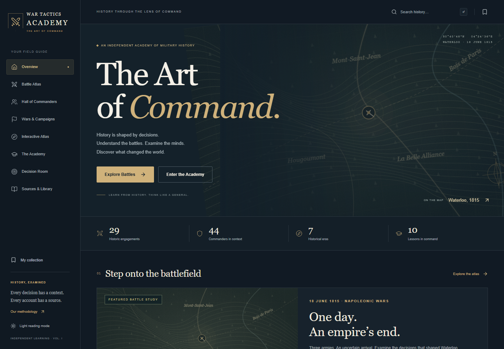

# War Tactics Academy

**The Art of Command — Learn from History. Think Like a General.**

[](https://github.com/darkonaumovski/war-tactics-academy/actions/workflows/deploy.yml)

**Live site: [darkonaumovski.github.io/war-tactics-academy](https://darkonaumovski.github.io/war-tactics-academy/)**

A historical learning application about military history, command decisions and their consequences. It combines a battle atlas, commander profiles, wars and campaigns, a decision simulator and a structured academy. It is built with Next.js, React, TypeScript, Prisma and SQLite, and is published as a fully static site on GitHub Pages. No login, paid service, remote database or API key is required.

The guiding principle is to explain what commanders knew, what they decided and why, and to keep historical fact, scholarly interpretation, uncertainty and counterfactual reasoning clearly apart.



## Features

### Historical catalog

- **140 engagements** across seven eras, classified as battles, sieges, operations or campaigns, with approximate locations. Operation Overlord (Normandy) is the first operation record.
- **140 detailed studies**, one for every engagement in the catalog, each with 14 analysis sections and an interactive replay of four or more phases. All 1,960 sections show which listed sources they draw on, with book and chapter locators for classical texts and chronicles and section names for handbooks.
- **304 command perspectives** across all 140 engagements. Each covers objective, available information, uncertainty, constraints, forces, terrain, logistics, decisions and retrospective interpretation, clearly presented as reconstructed reasoning rather than quotations.
- **106 commander profiles**, each with a command role (ruler-commander, field, naval, staff planner, or coalition and theater commander), ranks and titles, principal commands, a dated chronology, a notable decision, defeats and reverses, linked engagements and further reading. Commanders with two or more linked engagements get a career strip (one dot per engagement on a year axis, with a band for each war) and a dated list of those engagements with their outcomes. The catalog filters by era and command role, and any two commanders can be compared side by side without numerical ratings.
- **33 war pages** with principal participants, geographic scope, a chronology of key developments, key commanders and reading from linked studies and profiles; each links to its campaigns and engagements. Campaign pages draw a schematic map with the engagements numbered in date order (a locator map when a campaign has one engagement); the line joins them in that order and does not trace any army's movements. All ninety-two campaign pages add sourced text: a narrative for the sixty-two campaigns of the collections (the three of Alexander, the fourteen of Rome, the twelve of Napoleon, the fifteen of the First World War, including the four of the Serbian Front, and the eighteen of the Second World War) and a short context for the thirty one-engagement campaigns outside them. The Alexander, Roman, French Revolutionary, Napoleonic and both world war pages add an annotated war bibliography.
- **Six collections** (Alexander, Rome, Napoleon, the First World War, the Serbian Front and the Second World War), each with an introduction, a strategic arc that links the studies it summarises, a map of its engagements numbered in date order (joined by a line for Alexander and the Serbian Front), and a dated timeline. Membership follows wars and campaigns, so new studies join their collection automatically.

### Interactive learning

- **Battle replay** with pan, zoom, phase selection, playback, event popups, a legend and a full text timeline. Replay diagrams are labeled as schematic, never as surveyed troop positions.
- **Offline world atlas** using bundled Natural Earth geography; no map tile server is needed. Nearby markers merge into numbered groups that zoom in when selected, a region select frames dense areas such as the Balkans or northern Italy, markers that never separate fan out, and `/atlas?battle=<slug>` opens the map on one engagement.
- **Twenty-three decision exercises** (Waterloo, Cannae, Midway, Austerlitz, Alesia, Hastings, the Hydaspes, Pharsalus, Auerstedt, Jutland, Leyte Gulf, the Teutoburg Forest, Borodino, the Marne in 1914, Market Garden, and four on the Serbian Front: Cer, the Kolubara, the retreat of 1915 and Dobro Pole, and four from Napoleon’s campaigns written for the Leadership Lessons: raising the siege before Castiglione, stopping at Smolensk, the road home from Maloyaroslavets and the bridge at Leipzig): read the situation, choose under uncertainty, then compare with what happened and with an explicitly counterfactual interpretation.
- **Ten learning paths with 51 lessons**: Foundations of Military History, Classical Warfare, Alexander's Campaigns, 334–325 BCE, Rome at War, 197 BCE–451 CE, Napoleonic Warfare, Napoleon's Campaigns, 1796–1815, Industrial and World Wars, The First World War, 1914–1918, The Second World War, 1939–1945, and The Serbian Front, 1914–1918. Each lesson has objectives, historical cases, a concept diagram and a quiz; the Classical, Alexander, Rome, Napoleon, Industrial, First and Second World War and Serbian Front lessons add readings and seminar prompts.
- **Leadership Lessons from Napoleon**: nineteen lessons, each testing one conditional claim against his career through separate historical, strategic and psychological readings, with a failure case, a counter-case, the human cost, a quiz and a seminar prompt. The volume page sets each lesson’s strength beside its shadow, commander profiles and engagement studies link to the lessons that cite them, and the last lesson answers the volume’s question: did he get worse, or did the problem get harder?
- **Curated media library** of nine verified records: two official National Archives (UK) D-Day videos, loaded only on request through privacy-enhanced YouTube embeds; public-domain portraits of Grant and Eisenhower, also shown on their profiles; two historic maps; and three primary documents. Each record stores publisher, license, attribution and verification date.
- **Search and filters**: global search across battles, commanders, wars, campaigns, collections, lessons and leadership lessons. Engagements are found by name, place, date, war, campaign, commander or collection; every word of a query must match, in any order, ignoring case and accents, and exact titles rank first. Commanders filter by era and command role. The battle catalog filters by era, war, campaign, commander, collection, region and category, sorts by date or name, and switches between cards and a compact list; every filter is kept in the address, so a filtered view can be shared, and war, campaign, commander and collection pages link to their filtered catalog.
- **Saved progress** in the browser: bookmarks, recently visited records, lesson scores, decision choices and the light or dark theme. No account is needed.

### Design and accessibility

- Editorial dark interface with an optional light theme, a desktop sidebar and mobile navigation.
- Self-hosted typography: Cormorant Garamond for headings, Source Serif 4 for reading text, Inter for the interface and IBM Plex Mono for labels and coordinates.
- Subtle motion: home-page sections fade up as they scroll into view, and new timeline phases and quiz or decision feedback ease in. Nothing is hidden or moved for readers who prefer reduced motion, and content is visible without JavaScript.
- Every page has its own title, description, canonical URL and link-preview (Open Graph and Twitter) metadata, and a [sitemap](https://darkonaumovski.github.io/war-tactics-academy/sitemap.xml) lists all content pages.
- Keyboard navigation, a skip link, semantic landmarks and automated accessibility checks on 19 pages in the dark theme and 6 in the light theme.

## Technology

| Area       | Choice                                                                                 |
| ---------- | -------------------------------------------------------------------------------------- |
| Framework  | Next.js 16.4.3 App Router, static export (`output: "export"`)                          |
| UI         | React 19.3.1, TypeScript (strict), plain CSS with design tokens, Lucide icons          |
| Typography | `next/font` with four SIL Open Font License families, self-hosted                      |
| Motion     | Motion 13.5.1 through `LazyMotion`, respecting reduced-motion settings                 |
| Data       | Prisma 7.10.1 with SQLite, read at build time; Zod validation                          |
| Maps       | d3-geo with bundled Natural Earth data (`world-atlas`); SVG replay diagrams            |
| Testing    | Vitest and React Testing Library; Playwright (Chromium, Firefox, WebKit) with axe-core |
| Hosting    | GitHub Pages, deployed by GitHub Actions on every push to `main`                       |

## Quick start

Prerequisites: Node.js **22.12 or later** (tested with Node 24.20.0) and npm. SQLite is embedded; no separate database server is needed. Internet access is needed to install packages and browsers and to download fonts during the first build.

```sh
git clone https://github.com/darkonaumovski/war-tactics-academy.git
cd war-tactics-academy
npm ci
npm run db:setup
npm run dev
```

Open **http://127.0.0.1:3000**. In PowerShell environments that block npm's `.ps1` shim, use `npm.cmd` instead of `npm`.

The default database is `prisma/academy.db`. Copy `.env.example` to `.env` only to change it:

```env
DATABASE_URL="file:./prisma/academy.db"
```

`npm run db:setup` generates the Prisma client, applies the checked-in migrations and seeds the catalog. After pulling changes, run it again (or `npm run db:migrate` followed by `npm run db:seed`). The seed is transactional and idempotent: it updates existing records, replaces each record's source links and removes campaigns no longer in the data; other removed records are not pruned automatically. Browser progress is independent of the database.

## Production build and deployment

```sh
npm run build
npm start
```

`npm run build` reads the seeded catalog once and prerenders every page (480 pages, the not-found page and `sitemap.xml`) into `out/`. `npm start` serves `out/` on http://127.0.0.1:3000 with `scripts/serve-static.mjs`, which behaves like GitHub Pages: folder paths resolve to `index.html`, paths without a trailing slash redirect, and unknown paths return the custom `404.html` with a 404 status. The deployed site needs no server or database.

### GitHub Pages

The site is live at **[darkonaumovski.github.io/war-tactics-academy](https://darkonaumovski.github.io/war-tactics-academy/)**. [`.github/workflows/deploy.yml`](.github/workflows/deploy.yml) runs on every push to `main`. It installs dependencies, sets up and seeds the database, runs lint, type checking and unit tests, builds with `BASE_PATH=/<repository-name>/` and `SITE_URL` set to the Pages address, and publishes `out/`. If any check fails, the previous version stays live. Progress is visible in the repository's [Actions tab](https://github.com/darkonaumovski/war-tactics-academy/actions).

To set this up in a fork: Settings → Pages → Source: "GitHub Actions". On a free GitHub plan, Pages requires a public repository.

To preview the Pages URL layout locally:

```sh
BASE_PATH=/war-tactics-academy/ npm run build
BASE_PATH=/war-tactics-academy/ npm start
```

Then open http://127.0.0.1:3000/war-tactics-academy/. In Git Bash on Windows, prefix both commands with `MSYS_NO_PATHCONV=1` so the path is not rewritten.

Static hosting shapes a few details: URLs end with a trailing slash; search terms and battle filters in the query string (for example `?war=napoleonic&view=list`) are applied in the browser; the video tab is its own page (`/library/videos/`); portraits load directly from the holding archive because there is no image optimizer; and catalog changes reach the site only through a new build.

## Testing

```sh
npm run lint
npm run typecheck
npm test
npm run test:e2e:chromium
npm run test:e2e
npm run test:report
```

- **Unit and component tests** (Vitest, 90 tests): date formatting, search and filters, filters in the URL, route map layout, career strips, search matching and ranking, atlas regions and marker grouping, collection membership and arcs, phase selection, decision state, quiz scoring, persistence, data integrity, content depth, media records, metadata, and the quiz and media-library components.
- **Browser tests** (Playwright, 60 scenarios in each of Chromium, Firefox and WebKit, 180 in total): main workflows, campaign and collection route maps, commander career timelines, shareable catalog filters and the list view, collection timelines, bookmarks and saved progress, timelines, the atlas without network access and its grouping at 375 and 1280 pixels, search, metadata and the sitemap, scroll reveals and reduced motion, responsive layouts at 375, 768 and 1440 pixels, runtime errors, and axe-core accessibility checks.

Playwright builds the static export and serves it automatically, so tests run against the files that are deployed. `PLAYWRIGHT_BASE_URL` targets an already running server instead. Install browsers when needed with `npx playwright install chromium firefox webkit`. Reports are written to `playwright-report/` and `test-results/`.

See [verification results](docs/VERIFICATION.md) for the latest runs and [test strategy](docs/TEST_STRATEGY.md) for coverage. `node scripts/capture-preview.mjs` refreshes the screenshots in `docs/screenshots/` while the local server is running.

## Project structure

```text
app/                  Root layout, fonts, one route per page, sitemap, error and 404 pages, styles
components/views/     Page views, one module per section (battles, commanders, wars, academy…)
components/           Reusable UI, catalogs, maps, quizzes, search, media, motion and progress
data/                 Engagements, commanders, wars, research, learning, scenarios, leadership and media
lib/                  Types, Prisma client, catalog loader, validation, metadata and persistence
prisma/               Relational schema, migrations and transactional seed
tests/unit/           Vitest unit and component tests
tests/e2e/            Playwright workflow, accessibility and responsive tests
scripts/              Static server, preview capture and browser diagnostics
docs/                 Architecture, data model, sources, roadmap, test strategy and results
.github/workflows/    GitHub Pages deployment
```

Routes: `/`, `/battles`, `/battles/[slug]`, `/commanders`, `/commanders/[slug]`, `/commanders/compare`, `/wars`, `/wars/[slug]`, `/campaigns/[slug]`, `/collections`, `/collections/[slug]`, `/atlas`, `/academy`, `/academy/[courseSlug]`, `/academy/[courseSlug]/[lessonSlug]`, `/simulator`, `/simulator/[scenarioSlug]`, `/library`, `/library/videos`, `/leadership`, `/leadership/[commanderSlug]`, `/leadership/[commanderSlug]/[lessonSlug]`, `/about`, `/search` and `/saved`, plus `/sitemap.xml`. Each dynamic route lists its pages at build time, so unknown paths and slugs show the custom not-found page. More detail is in [architecture](docs/ARCHITECTURE.md) and the [data model](docs/DATA_MODEL.md).

## Historical methodology

Historical fact, scholarly interpretation, uncertainty and counterfactual analysis are explicitly distinguished. Detailed studies cite institutional histories and primary texts, with caveats about retrospective testimony and conflicting evidence. The 140 studies are concise editorial syntheses, not full scholarly monographs.

Study sections name the listed sources they draw on. These references were assigned only after each source page had been read; sources that could not be opened are listed but not attached to individual sections. They are section-level references, not footnotes for every sentence. Commander chronologies and war overviews summarize well-established events; their further reading is not a citation for each entry. All source links were checked, and dead links were replaced with verified pages.

No casualty totals, private thoughts, invented quotations, precise intelligence logs or commander performance ratings are fabricated. Geographic markers show approximate places. Replay geometry is an abstract teaching schematic, not verified troop coordinates or surveyed movements. Political and civilian consequences, including atrocities, remain part of the historical context.

See the [source audit](docs/SOURCE_AUDIT.md) and [commander sourcing notes](docs/COMMANDER_SOURCES.md). Specialist review and fuller contrasting bibliographies remain important next steps.

## Media and licensing

Map art, monograms and diagrams are original SVG graphics. Monograms are graphic identifiers, not likenesses; only commanders with an item-level public-domain portrait record show a photograph. Natural Earth world geography is public domain, distributed through `world-atlas`; [Natural Earth terms](https://www.naturalearthdata.com/about/terms-of-use/) apply.

The four typefaces are licensed under the SIL Open Font License. `next/font` downloads them at build time and serves them from the site, so visitors' browsers never contact Google. Only the Latin files (about 84 KB) are preloaded; other character ranges, such as Vietnamese, load only on pages that use them.

External readings remain with their publishers; no publisher artwork or full article is copied. Curated media lives in `data/media.json`, is validated by `lib/media.ts` and is also seeded into the `MediaResource` table with its source, publisher, license and attribution. Video IDs were checked against the publisher's own page and YouTube oEmbed; nothing is autoplayed or rehosted. Portraits load directly from the holding archive and fall back to a text notice with attribution if the image cannot load. Historic maps and documents are linked, not reproduced. See [media provenance](docs/MEDIA_RESEARCH_UPDATE.md).

## Release history

All releases are deployed to the live site.

| Commit    | Change                                                                                                                                                                                                                                                                                   |
| --------- | ---------------------------------------------------------------------------------------------------------------------------------------------------------------------------------------------------------------------------------------------------------------------------------------- |
| `ed95965` | Leadership Lessons from Alexander the Great adds four lessons on taking over his father’s army, adapting the method, staying at Tyre, and Parmenion’s advice (batch A2).                                                                                                                 |
| `6e06103` | Leadership Lessons from Alexander the Great opens, marked in progress, with three pilot lessons on reading a lost record, the king in the front rank, and the refusal at the Hyphasis (batch A1).                                                                                        |
| `5941d1c` | Leadership Lessons prepares its second volume, on Alexander the Great: an evidence pass, an agreed thirteen-lesson curriculum, and support for a volume shared by several commanders, for the Serbian Supreme Command (Phase 0).                                                         |
| `cd7e937` | A prompt for the next Leadership Lessons volumes: Alexander the Great, then the Serbian Supreme Command of 1914–1918, with a readiness analysis of other candidates.                                                                                                                     |
| `5bb4a19` | Local static serving of Windows builds finds nested segment prefetch files, so prefetches no longer fail under `npm start` and the end-to-end tests. The deployed site was unaffected.                                                                                                   |
| `71248de` | Four Decision Room exercises drawn from the Napoleon Leadership Lessons (Castiglione, Smolensk, Maloyaroslavets, Leipzig) and a template for later volumes (Phase 4).                                                                                                                    |
| `66c548d` | Leadership Lessons are linked across the site: a strength-and-shadow table on the Napoleon volume page, lesson links on engagement studies and commander profiles, search, sitemap and an About section (Phase 3).                                                                       |
| `7bdb83c` | Leadership Lessons from Napoleon is complete, with lessons on succession and on the ledger of costs, which answers the volume’s question (batch L6).                                                                                                                                     |
| `c5b96d9` | Leadership Lessons adds four lessons on victory without settlement, dissent, the last reserve, and leaving the army (batch L5).                                                                                                                                                          |
| `6c9954a` | Leadership Lessons adds four lessons on delegation, the headquarters, the bottleneck, and rivals who learn (batch L4).                                                                                                                                                                   |
| `54f8473` | Leadership Lessons adds three lessons on being seen where it is hardest, recognition, and words that win or spend trust (batch L3).                                                                                                                                                      |
| `142c023` | Leadership Lessons adds three lessons on what Napoleon inherited, plans that survive error, and speed (batch L2).                                                                                                                                                                        |
| `55fc6e5` | Leadership Lessons opens with three lessons from Napoleon, on reading his record, intuition, and knowing when to stop (batch L1).                                                                                                                                                        |
| `542ecbc` | List pages receive only the fields they display, cutting page data and rendering cost on phones.                                                                                                                                                                                         |
| `bbb42d8` | Groundwork for Leadership Lessons: an evidence pass grading each planned Napoleon lesson, with data types and validation of the editorial rules (Phase 0).                                                                                                                               |
| `59995ab` | All 51 lessons gain three questions with feedback on each answer, and 45 gain an unscored source check drawn from sourced disagreements (batches Q1–Q2).                                                                                                                                 |
| `71dc606` | The last 62 campaign pages gain sourced text: narratives for the Second World War and Rome, short contexts for 30 one-engagement campaigns, and 12 war bibliographies (batches K5–K7).                                                                                                   |
| `00222c8` | All fifteen First World War campaigns, the Serbian Front among them, gain sourced narratives, and the First World War page an annotated bibliography, from 1914-1918-online and memoirs (batch K4).                                                                                      |
| `6ef62bc` | Napoleon's last four campaigns, from Russia to Waterloo, gain sourced narratives, and the Napoleonic Wars page an annotated bibliography, with Russian-headquarters and Prussian sources (batch K3).                                                                                     |
| `f9cacac` | Napoleon's eight campaigns from Toulon to 1809 gain sourced narratives, and the French Revolutionary Wars page an annotated bibliography, with Austrian, Prussian and Egyptian sources (batch K2).                                                                                       |
| `a302455` | The three Alexander campaigns gain sourced narratives drawn from Briant, Lendering and Arrian, and the Alexander war page an annotated bibliography (batch K1).                                                                                                                          |
| `c5ff058` | Red Cliffs, Nagashino, Hansan Island, Pratapgad and Dien Bien Phu gain primary texts from Chinese, Japanese, British and Vietnamese sides; no study now cites fewer than four sources (batch P10).                                                                                       |
| `de49f08` | Marathon, Dara, Arsuf, Sedan, Atlanta and Rymnik gain a primary text each: Pausanias, Zachariah of Mitylene, the Itinerary of Richard I, Wimpffen and Ducrot, Johnston and Suvorov (batch P9).                                                                                           |
| `5f8ccce` | Verdun, Friedland and Vendémiaire deepened with Falkenhayn's and the Crown Prince's memoirs, Sir Robert Wilson's account from the Russian side, and Lavalette and the royalist Mallet du Pan, with two new perspectives (batch P8).                                                      |
| `fb8d46f` | Seven Alexander studies deepened with Diodorus, Plutarch and the Encyclopaedia Iranica's articles on the Persian and Iranian side by Badian, Shahbazi, Schmitt, Chaumont and Briant (batch P7).                                                                                          |
| `2bb1895` | Zama, Alesia, Pharsalus, Actium and Adrianople deepened with the independent ancient narratives of Livy, Plutarch, Appian and Cassius Dio, and the Gothic side from Jordanes (batch P6).                                                                                                 |
| `f0214c2` | Blenheim, Vicksburg, Karnal and Mohi deepened with the Bavarian, Confederate, Mughal and Hungarian side, from the German biographies of Max Emanuel, Jefferson Davis's memoir, Jadunath Sarkar and the Hungarian Historical Review (batch P5).                                           |
| `8bbefd8` | The Berezina, Bautzen, Laon and Arcis-sur-Aube deepened with Napoleon's own words and the Russian, Prussian and Austrian side, from the Presidential Library and the German biographies of Blücher and Schwarzenberg (batch P4).                                                         |
| `72a7361` | Poland 1939, the Atlantic, Imphal–Kohima and Bagration deepened with the German, Polish, Japanese and Belarusian side, from LeMO, the Bundesarchiv, the IPN, JACAR, NIDS and a Belarusian state archive (batch P3).                                                                      |
| `f8d4672` | Brusilov, Caporetto, Stalingrad and El Alamein deepened with the German and Austro-Hungarian side, from LeMO, the Neue Deutsche Biographie on Conrad, Paulus and Rommel, and Ludendorff's memoirs (batch P2).                                                                            |
| `b62af7d` | The Marne, Gallipoli, Cambrai and Operation Michael deepened with the German and Ottoman side, from LeMO, the Neue Deutsche Biographie and the memoirs of Liman von Sanders and Ludendorff (batch P1).                                                                                   |
| `2c238f9` | Hastings, Agincourt, Hattin and Gettysburg deepened with the side their sources left out: William of Malmesbury and the Bayeux Museum, French reactions to Agincourt, Bahā' al-Dīn's Life of Saladin, and Lee's own report (batch D4); all 1,960 sections now cite sources.              |
| `c4efb6f` | France 1940, the Battle of Britain, Market Garden and the Battle of the Bulge deepened with the German side, from LeMO, the Bundesarchiv and the Neue Deutsche Biographie, and with the Dutch railway strike for Market Garden (batch D3).                                               |
| `9ec036e` | Coral Sea, Guadalcanal, Iwo Jima and Singapore deepened with the Japanese side, from officers' 1945 interrogations and Japan's National Institute for Defense Studies (batch D2).                                                                                                        |
| `59c4779` | Montenotte, Lodi, Castiglione and Austerlitz deepened with Napoleon's own words and Austrian and Russian accounts, including Langeron's memoirs of Austerlitz (batch D1).                                                                                                                |
| `be91f29` | Yehuling for Genghis Khan (batch G4), from the Secret History of the Mongols and the Jin and Yuan dynastic histories, with the Mongol invasion of the Jin; Gqokli Hill left out for lack of a reliable source, so Shaka remains unlinked.                                                |
| `ee27f46` | Battles for four more commanders (batch G3): Vicksburg for Grant and Sherman, the Atlanta campaign for Sherman, Adwa for Menelik II and Pratapgad for Shivaji, with Shivaji's war with Bijapur, the First Italo-Ethiopian War and a Sub-Saharan Africa atlas region.                     |
| `b879ed9` | Battles for four more commanders (batch G2): Dara for Belisarius, Arsuf for Richard I and Saladin, Leuthen for Frederick the Great and Rymnik for Suvorov, with the Byzantine–Sasanian war of 527–532, the Seven Years' War and the Russo-Turkish War of 1787–1791.                      |
| `7efc240` | Battles for four commanders without one (batch G1): Mohi for Subutai, Hansan Island for Yi Sun-sin, Nagashino for Oda Nobunaga and Tokugawa Ieyasu, and Karnal for Nader Shah, with the Mongol invasion of Europe, the Imjin War and Nader Shah's invasion of India.                     |
| `cff24a5` | Lighthouse results after the prefetch fixes recorded in the verification record: page weight down 58–81%, the Waterloo study at 87 on mobile, and accessibility and best practices at 100 on every page measured.                                                                        |
| `4da3776` | Lighthouse fixes: heavy routes prefetched only on hover, focus or touch (page weight down 58–81%), a site icon, and heading order; accessibility and best practices at 100 on every page measured.                                                                                       |
| `c11ccf5` | Command perspectives for Marathon, Miltiades and Datis, from Herodotus and Encyclopaedia Iranica; every study now has perspectives.                                                                                                                                                      |
| `bb00c3d` | The mobile menu button and theme toggle stay disabled until hydration, fixing taps lost on slow devices and the flaky mobile navigation test.                                                                                                                                            |
| `66ec46b` | Four new decision exercises: the Teutoburg Forest as Varus, Borodino as Napoleon, the Marne as Joffre and Market Garden as the airborne planners; nineteen in all.                                                                                                                       |
| `308f988` | Soviet-side sources for Kursk and Berlin: Zhukov's and Vasilevsky's accounts of Kursk, Zhukov's and Konev's memoirs of Berlin, and a Konev perspective.                                                                                                                                  |
| `266cec1` | Pearl Harbor, Leyte Gulf, Okinawa and Berlin studies deepened with sources from the other side, including the Kurita and Ozawa interrogations and the Okinawa Prefectural Peace Memorial Museum; every study now lists at least three sources (batch T4).                                |
| `816d9a0` | Tannenberg, Verdun, El Alamein and Kursk studies deepened with seven more read sources, including Hindenburg's order of the day and Falkenhayn's Christmas memorandum (batch T3).                                                                                                        |
| `17d0e03` | Saratoga, Sedan, Tsushima and Dien Bien Phu studies deepened with six more read sources: Burgoyne's own narrative, Moltke's history of the war, Japanese archival research and Vietnamese scholarship (batch T2).                                                                        |
| `657f202` | Yarmouk, Ain Jalut, Panipat and Sekigahara studies deepened with nine more read sources, including Rashid al-Din's Mongol account of Ain Jalut and Encyclopaedia Iranica on Babur (batch T1).                                                                                            |
| `2409b17` | Final pass of the battle expansion (Stage G): verification, test strategy, architecture and roadmap docs, the About page and the Academy note describe the current edition; browser-test timing fixes; all 180 browser tests pass.                                                       |
| `e3d3315` | The Second World War, 1939–1945, a five-lesson course from Poland in 1939 to the western Allies in 1944, and a Leyte Gulf decision exercise as Halsey (Stage F batch F5); Stage F complete.                                                                                              |
| `12099e1` | The First World War, 1914–1918, a five-lesson course from the plans of 1914 to the new methods of 1918, and a Jutland decision exercise as Jellicoe (Stage F batch F4).                                                                                                                  |
| `31047f9` | Napoleon's Campaigns, 1796–1815, a five-lesson course from Montenotte to Waterloo, and an Auerstedt decision exercise as Davout (Stage F batch F3).                                                                                                                                      |
| `ef0673f` | Rome at War, 197 BCE–451 CE, a five-lesson course from Cynoscephalae to the Catalaunian Plains, and a Pharsalus decision exercise (Stage F batch F2).                                                                                                                                    |
| `360267b` | Alexander's Campaigns, 334–325 BCE, a five-lesson course from the Granicus to the Hydaspes, and a Hydaspes decision exercise (Stage F batch F1); simulator cards numbered 01–11.                                                                                                         |
| `6e4aa4f` | Profiles of Constantine I, Aetius and Attila (Stage E batch E12), linked to the Milvian Bridge and the Catalaunian Plains; Stage E complete with 46 new profiles.                                                                                                                        |
| `b983ab2` | Profiles of Agrippa, Arminius, Boudica and Titus (Stage E batch E11), linked to Actium, the Teutoburg Forest, Watling Street and the siege of Jerusalem.                                                                                                                                 |
| `790b07c` | Profiles of Darius III, Porus, Pompey and Augustus (Stage E batch E10), the first ancient profiles, linked to Issus, Gaugamela, the Hydaspes, Pharsalus and Actium.                                                                                                                      |
| `591cdd5` | Profiles of Bagration, Barclay de Tolly and Bennigsen (Stage E batch E9), completing the Napoleonic profiles; linked to the engagements from Austerlitz to Leipzig that their sources confirm.                                                                                           |
| `88727bd` | Profiles of Lannes, Blücher, Archduke Charles and Schwarzenberg (Stage E batch E8), linked to the engagements from Acre to Waterloo that their sources confirm.                                                                                                                          |
| `326069f` | Profiles of Davout, Ney, Murat and Masséna (Stage E batch E7), the first Napoleonic profiles, linked to the engagements from Montenotte to Waterloo that their sources confirm.                                                                                                          |
| `6ce57bc` | Profiles of Halsey, Spruance, Yamashita, Kuribayashi and Chuikov (Stage E batch E6), completing the Second World War profiles; linked to Midway, Guadalcanal, Leyte Gulf, Iwo Jima, Okinawa, Singapore, Stalingrad and Berlin.                                                           |
| `eacf5b6` | Profiles of Dowding, Slim, Dönitz and Konev (Stage E batch E5), linked to the Battle of Britain, Imphal and Kohima, the Battle of the Atlantic, Moscow, Kursk and Berlin; the E4 German profiles give their state as Nazi Germany.                                                       |
| `4ce0ad9` | Profiles of Rundstedt, Manstein, Guderian and Model (Stage E batch E4), the first Second World War profiles, with their part in war crimes and in the court of honour after the 20 July plot.                                                                                            |
| `afbb84f` | Profiles of Pershing, Monash and Currie (Stage E batch E3), completing the First World War profiles; linked to the Somme, Passchendaele, Amiens and the Meuse-Argonne.                                                                                                                   |
| `913749f` | Profiles of Jellicoe, Scheer, Pétain and Allenby (Stage E batch E2), linked to Jutland, Verdun, First and Second Ypres and Megiddo; the naval-commander filter test counts from the data.                                                                                                |
| `db8aa91` | Profiles of Joffre, Moltke the Younger, Hindenburg and Ludendorff (Stage E batch E1), the first commander profiles of Stage E, linked to the engagements their sources confirm.                                                                                                          |
| `108ca77` | Detailed studies of Okinawa and Berlin (Second World War batch W2-5), completing the Second World War collection with 23 studies and Stage D; Nimitz, Zhukov and Rokossovsky linked where sources confirm their roles.                                                                   |
| `cf4b2b7` | Detailed studies of Market Garden, Leyte Gulf, the Battle of the Bulge and Iwo Jima (Second World War batch W2-4); the replay treats the Atlantic, the Coral Sea and Leyte Gulf as naval; Montgomery, Eisenhower, Patton, MacArthur and Nimitz linked where sources confirm their roles. |
| `15f740e` | Detailed studies of Guadalcanal, the Battle of the Atlantic, Imphal and Kohima and Operation Bagration (Second World War batch W2-3); a North Atlantic atlas region and a wider South Asia region; Rokossovsky linked to Bagration.                                                      |
| `26d64dd` | Detailed studies of Moscow, Pearl Harbor, Malaya and Singapore and the Coral Sea (Second World War batch W2-2), with the Sook Ching massacres stated as fact; a South-east Asia and South-west Pacific atlas region; Zhukov and Yamamoto linked where sources confirm their roles.       |
| `024db95` | Detailed studies of the invasion of Poland, the Battle of France, the Battle of Britain and Operation Barbarossa (Second World War batch W2-1), with the human cost in Poland and the east stated as fact; Rommel and Zhukov linked where sources confirm their roles.                   |
| `3184d88` | Detailed studies of Megiddo and the Meuse-Argonne (First World War batch W1-4), completing the First World War collection with 30 studies and Stage C; Mustafa Kemal and Foch linked where sources confirm their roles.                                                                  |
| `866c057` | Detailed studies of Passchendaele, Cambrai, Operation Michael and Amiens (First World War batch W1-3); Haig and Foch linked where sources confirm their roles.                                                                                                                           |
| `9ceafaf` | Preview launch configuration (`.claude/launch.json`) for the local development server.                                                                                                                                                                                                   |
| `da5e621` | Detailed studies of Jutland, the Somme, the Brusilov offensive and Caporetto (First World War batch W1-2); Haig, Foch, Gallwitz, Brusilov, Conrad, Otto von Below and Rommel linked where sources confirm their roles.                                                                   |
| `f1f8c75` | Detailed studies of the First Battle of the Marne, the First and Second Battles of Ypres and the Gallipoli campaign (First World War batch W1-1); Foch, Haig, Falkenhayn and Mustafa Kemal linked where sources confirm their roles.                                                     |
| `e27e187` | Search finds engagements by war, campaign, commander and collection, matches every word in any order and ranks exact titles first; Stage B complete.                                                                                                                                     |
| `0b54499` | Commander pages with two or more linked engagements show a career strip (engagements by year, banded by war) and a dated timeline in place of the card grid.                                                                                                                             |
| `64add69` | Schematic route maps on campaign and collection pages: engagements numbered in date order, joined by a line where that is meaningful, with a locator map for single-engagement campaigns.                                                                                                |
| `7bba6e6` | Battle catalog filters by war, campaign, commander and collection, with sorting, a compact list view and every filter kept in the address; war, campaign, commander and collection pages link to their filtered catalog.                                                                 |
| `8f34dc6` | Six collection pages (Alexander, Rome, Napoleon, the First World War, the Serbian Front and the Second World War), each with an introduction, a strategic arc linked to its studies and a dated timeline.                                                                                |
| `e4e5074` | Readable atlas: numbered marker groups that zoom in when selected, a region select, fan-out for markers that never separate, labels, drag to pan and `?battle=` deep links from every study page.                                                                                        |
| `c7676cb` | Remaining-work prompt updated: Stage A (Napoleon N4–N7) marked done; Stage B (app work at about 110 engagements) is next.                                                                                                                                                                |
| `e254f6b` | Detailed studies of 13 Vendémiaire, Maloyaroslavets, Hanau, and Brienne and La Rothière (Napoleon batch N7), completing the Napoleon collection with 34 studies; Kutuzov linked to Maloyaroslavets.                                                                                      |
| `e9f9d26` | Detailed studies of Leipzig, the Six Days, Craonne and Laon, Arcis-sur-Aube and Ligny (Napoleon batch N6), completing the core Napoleon list and opening the Campaign in France, 1814.                                                                                                   |
| `9a5e145` | Detailed studies of Borodino, the Berezina, Lützen, Bautzen and Dresden (Napoleon batch N5), opening the German campaign of 1813; Kutuzov linked to Borodino.                                                                                                                            |
| `96a2f28` | Detailed studies of Eckmühl, Aspern-Essling, Wagram and Smolensk (Napoleon batch N4), opening the War of the Fifth Coalition and the Russian campaign of 1812, with the 1809 chronology added.                                                                                           |
| `8f8defd` | The remaining-work prompt and plan (`docs/REMAINING_WORK_PROMPT.md`), covering Napoleon N4–N7, the app work, the world wars, commander profiles and courses.                                                                                                                             |
| `a117808` | Detailed studies of Ulm, Jena–Auerstedt, Eylau and Friedland (Napoleon batch N3), with the 1806–07 chronology corrected and Napoleon linked to every Napoleonic study.                                                                                                                   |
| `a63ae25` | A five-lesson Serbian Front course and four decision exercises (Cer, the Kolubara, November 1915, Dobro Pole); the optional Serbian Front engagements declined.                                                                                                                          |
| `c825061` | Profiles of the German commanders Mackensen, Falkenhayn, Gallwitz, Seeckt and Otto von Below, completing the Serbian Front commander profiles.                                                                                                                                           |
| `cc09f5e` | Profiles of the Austro-Hungarian commanders Potiorek, Conrad, Kövess and Sarkotić.                                                                                                                                                                                                       |
| `71d930a` | Profiles of Crown Prince Alexander, Pavle Jurišić Šturm and Kosta Pećanac; Bojović's date of death narrowed to January 1945.                                                                                                                                                             |
| `6f201ec` | Profiles of the four Serbian vojvode: Putnik, Stepanović, Mišić and Bojović, linked to the engagements their sources confirm.                                                                                                                                                            |
| `b5cfb2a` | Detailed studies for the breakthrough at Dobro Pole and the liberation of Serbia, completing the core engagements of the Serbian Front.                                                                                                                                                  |
| `6ea85b6` | Detailed studies for Kajmakčalan, the Monastir offensive and the Toplica Uprising; new Macedonian front and Occupation of Serbia campaigns.                                                                                                                                              |
| `6f1b2ea` | Detailed studies for the Kolubara, Belgrade 1915, the 1915 invasion, the retreat through Montenegro and Albania, and Mojkovac; new Serbian campaign of 1915.                                                                                                                             |
| `02a9b6c` | Detailed studies for Cer, Syrmia, the Drina and the Romanija offensive, opening the Serbian Front collection with the Serbian campaign of 1914.                                                                                                                                          |
| `57aa9aa` | Groundwork for the Serbian Front collection; Serbia and Montenegro added to the First World War with a checked Serbian Front chronology; engagements in the same year now ordered by date.                                                                                               |
| `a4c76c2` | Detailed studies for Rivoli, the Pyramids, Acre, Aboukir and Marengo, completing the French Revolutionary Wars; Napoleon linked to each.                                                                                                                                                 |
| `26f1f2a` | Detailed studies for Toulon, Montenotte, Lodi, Castiglione and Arcole, opening the Napoleon collection; Napoleon linked to each.                                                                                                                                                         |
| `a8afc32` | Detailed studies for Jerusalem, the Milvian Bridge, Adrianople and the Catalaunian Plains, completing the Roman collection; four war chronologies corrected.                                                                                                                             |
| `98c9685` | Detailed studies for Pharsalus, Actium, Teutoburg and Watling Street; Caesar linked to Pharsalus; three war chronologies corrected against read sources.                                                                                                                                 |
| `4466f60` | Detailed studies for Zama, Cynoscephalae, Pydna and Carrhae, opening the Roman collection; Hannibal and Scipio linked to Zama; two war chronologies corrected.                                                                                                                           |
| `b66a6f9` | Detailed studies for the Persian Gate, Jaxartes, Sogdian Rock and Hydaspes, completing Alexander's campaign; two new campaigns; Alexander's profile linked to each; source audit extended.                                                                                               |
| `18030e0` | Detailed studies for the Granicus, Issus, Tyre and Gaza, the first batch of Alexander's campaign; Alexander's profile linked to each; source audit extended.                                                                                                                             |
| `bbf87cf` | Catalog rows and studies split into per-collection modules; ten new wars for the Roman and Revolutionary-era expansion, with participants, scope and chronology.                                                                                                                         |
| `e6658a4` | Detailed studies for Blenheim, Saratoga, Sedan, Tsushima and Tannenberg, the final batch: every catalog engagement now has a detailed study; source audit extended.                                                                                                                      |
| `d44f192` | Detailed studies for the Fall of Constantinople, the First Battle of Panipat, Sekigahara and Breitenfeld, the third batch of the remaining catalog engagements; source audit extended.                                                                                                   |
| `c8997fd` | Detailed studies for the Battle of Red Cliffs, Yarmouk, Hattin and Ain Jalut, the second batch of the remaining catalog engagements; tests now read the study list from the data file; source audit extended.                                                                            |
| `9af01ec` | Detailed studies for Verdun, the Second Battle of El Alamein, Kursk and Dien Bien Phu, the first batch of the remaining catalog engagements; source audit extended.                                                                                                                      |
| `501790c` | Detailed studies for Gaugamela, Agincourt, Gettysburg and Operation Overlord (Normandy), each with section-level references, a four-phase replay and two command perspectives; source audit extended.                                                                                    |
| `3686290` | Self-hosted typography (four Open Font License families) and subtle Motion animations that respect reduced motion; accessibility checks extended to 14 pages.                                                                                                                            |
| `bcad0f9` | One App Router route per page, page views split into section modules, full page metadata and a sitemap; Operation engagement type, with Operation Overlord within the North-west Europe campaign.                                                                                        |
| `cea7872` | Converted to a static export and published on GitHub Pages with an automatic deploy workflow; search and filters read the URL in the browser.                                                                                                                                            |
| `dd2ab3f` | Commander chronologies and command records, war context pages, extended and new command perspectives, section-level source references, three new decision exercises; dead source links replaced.                                                                                         |
| `7931e1f` | Classical Warfare and Industrial and World Wars courses, the curated media library with portraits and official videos, and their tests.                                                                                                                                                  |
| `1728672` | First edition: catalog, eight studies, atlas, replay, commanders, academy, simulator, bookmarks and tests.                                                                                                                                                                               |

## Known limitations

- The ten learning paths are introductory editorial courses (one question per lesson), not reviewed university curricula.
- The 140 battle analyses and 106 commander profiles need deeper scholarly review, fuller biographies and sentence-level citations before being treated as an academic reference work. Study sections are still brief.
- War pages give orientation, not comprehensive operational histories; only the Alexander, Roman, French Revolutionary, Napoleonic and world war pages have a dedicated bibliography. The thirty one-engagement campaigns outside the collections have only a short context.
- Replay diagrams explain abstract relationships; they do not simulate combat or reconstruct exact formations. Atlas locations and Natural Earth coastlines are approximate modern context.
- The media library is a small starting collection (nine records); the two videos cover only D-Day. Embeds and archive images depend on third-party availability.
- Progress belongs to one browser and is lost if its storage is cleared; storage failures are reported without crashing.
- The site is static: the database is a build-time content store and updates require a rebuild. Accounts, synchronization, a historian-facing editor and sentence-level citation workflows are future work.
- Automated accessibility checks supplement, but do not replace, manual screen-reader testing. Lighthouse has been run on the live site and, after the payload work, on a local build (see the verification record); the battle catalog remains the slowest of the pages measured on phones.

See the [prioritized roadmap](docs/PRODUCT_ROADMAP.md).
